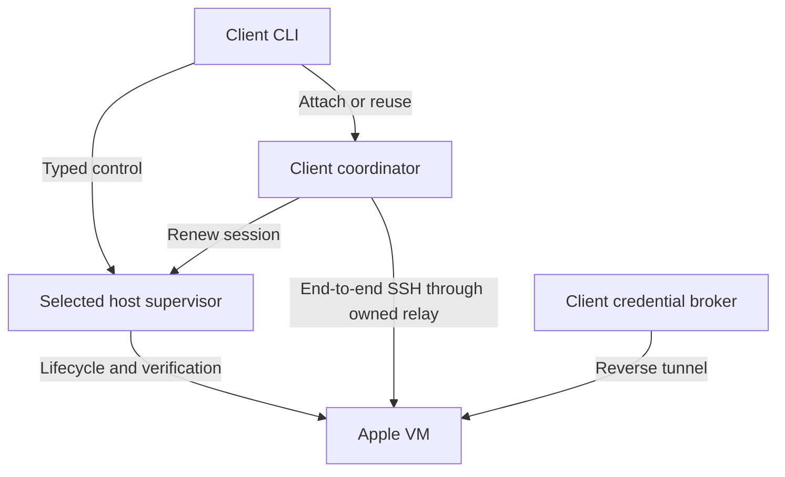

# Implementation specification: local and remote VM execution for iso

**Document ID:** ISO-HOST-001  
**Version:** 1.0 draft for implementation  
**Date:** 2026-10-09  
**Repository baseline:** [chr33s/iso at 47d17ba2524b145b229abcf42c85f8b5f0071e65][baseline]  
**Status:** Host-control foundation implemented in Swift (see [Implementation status](#implementation-status)). Native qualification has run on two physical Macs (Q1–Q3 including live-provider broker failure, and Q4 sleep/wake, reboot and logout). Q4 logout passes once `iso` is allowed under Local Network privacy on the worker; without that permission guest access fails (see [Native evidence](#native-evidence)). The permission follows the binary's signing identity, so a release needs a stable signature before a remote worker survives updates without a new grant.

## Implementation status

Recorded 2026-10-10 against the working tree that added `Sources/IsoHost/HostControl/`.
"Implemented" means code plus focused tests in `tests/swift/IsoHostTests/HostControl*Tests.swift`;
it never means a native Mac-to-Mac gate passed. The two-Mac runner
[`tests/integration-remote-host.py`](../../tests/integration-remote-host.py) records every native
case it cannot execute as `blocked`.

| Task | State | Where |
| --- | --- | --- |
| T01 fixture | Runner implemented with `--remote` (two Macs) and `--local` (this Mac's service, real VMs); see [testing](../testing.md#host-control) | `tests/integration-remote-host.py` |
| T02 identities, bounded wire | Implemented | `IsoCore/HostIdentity.swift`, `HostWire.swift`, `HostProtocol.swift`, `HostControlError.swift` |
| T03 persistent local service | Implemented (daemon, exclusive service lock, private sockets with provenance by socket, peer-uid check, launchd user service, new epoch per start) | `HostSupervisor.swift`, `LocalHostControl.swift`, `HostService.swift` |
| T04 pinned SSH frontend | Implemented | `SSHHostControl.swift` |
| T05–T07 ledger, lifecycle, recovery | Implemented; `AppleNativeHost` reuses `AppleBackend` under each VM's recorded network policy, with a reserved runtime name and a fixed boot deadline; exercised end to end against the stateful fake runtime | `OperationStore.swift`, `HostSupervisor.swift`, `NativeHost.swift` |
| T08 volatile access | Implemented | `AccessSessions.swift` |
| T09 owned relay | Implemented | `GuestRelay.swift`, `HostService.swift` |
| T10 configuration realms | Implemented | `IsoConfiguration/ExecutionHostConfig.swift` |
| T11 enrollment, placement | Implemented | `HostCommands.swift`, `ClientBindings.swift` |
| T12 artifacts | Implemented | `ArtifactStore.swift`, `ArchiveValidator.swift` |
| T13 image setup on the worker | Implemented: `image.ensure` runs the worker's own setup as a durable, idempotent, one-per-image operation; `vm.create`/`run.create` require a worker-verified image | `HostSupervisor.swift`, `NativeHost.swift`, `iso host image` |
| T14 project lifecycle on a selected host | Implemented as `iso host up HOST [PATH]` (create-or-reuse by host-qualified binding, start, push); `unknown` never triggers recreation | `HostWorkflowCommands.swift` |
| T15 status/machine output | Implemented: `iso list --all-hosts` with additive host fields and `host_failures`; `capabilities` gains a static `host_control` block | `ReadCommands.swift`, `MachineResponses.swift` |
| T16 shared route | Implemented: `SSHTarget.proxyCommand` carries the relay, so ssh/scp/rsync/tar and tunnels use one pinned route | `SSH.swift`, `ClientBindings.swift` |
| T17 coordinator | Implemented: per-command sessions, plus `iso host session --detach` (one per binding, lock-held, reused by other commands while its boot is current) | `ClientBindings.swift` |
| T18 broker/egress composition | Implemented: for filtered VMs the grant carries the worker's natively proven boot policy; the client's confined proxy binds its signed readiness to it through the relay; renewal re-checks and revokes on loss | `HostSupervisor.swift`, `NativeHost.swift`, `ClientBindings.swift` |
| T19 workspace transfer | Implemented: `iso host push` (one-way copy) | `ClientBindings.swift` |
| T20 offline stage review | Implemented: `iso host pull` stages through the relay; `--apply` needs no host; stages are keyed by instance id and survive destroy | `ClientBindings.swift` |
| T21 interactive agents | Implemented: `iso host agent HOST NAME claude|codex` reuses the existing bootstrap with a client-side broker; Codex ChatGPT auth is refused remotely | `ClientBindings.swift` |
| T22 editor | Implemented: `iso host editor HOST NAME code|zed` (sandboxed only) | `EditorLauncher.swift`, `SandboxedEditorSession.swift` |
| T23 forwards | Implemented: `iso host forward` binds client loopback inside the session | `HostWorkflowCommands.swift` |
| T24–T25 disposable runs | Implemented end to end: service-side run ownership and `iso host run` / `run-results` (verified download into a client stage, then acknowledgment) | `RunStore.swift`, `HostRuns.swift`, `HostWorkflowCommands.swift` |
| T26 local capabilities through the service | Implemented for service-managed instances: resize, commit and restore dispatch locally and are refused over SSH; macOS computer use is not dispatched (macOS guests are not service-managed) | `HostSupervisor.swift`, `iso host vm resize/commit/restore local …` |
| T27 migration | Implemented: preview; `--activate` prepares a durable handoff under the mutation lock and releases it; the service completes activation-only under its ownership lock (rechecks stopped boundary, journals, writers and identities), adopts stopped Linux instances (marker + records + `local` bindings), fences the owner record against older binaries and commits; resumable after a crash; `--rollback` before completion. Adopted instances are mutated only by the service (the legacy path refuses); macOS and disposable-run instances stay legacy | `HostMigration.swift`, `AppleBackend.requireWriter` |
| T28 cancellation | Implemented | `HostSupervisor.swift` |
| T29 docs | Implemented | `docs/` |
| T30 release gates | Fault-injection entries for every new refusal; native Q1 runner. Native results: see below | `scripts/swift-host-fault-injection.py` |

### Native evidence

`tests/integration-remote-host.py --local` ran on the development Mac (macOS
27.0.1, Apple Silicon) with a freshly built `iso-sandbox`, real VMs and stub
agents, through the local host service (same supervisor, ledger, relay and
session code as a remote host; the SSH frontend is not on this path). Result
`pass` on every case: setup and service activation, inspect with a qualified
runtime, hello latency (p50 17 ms, p95 19 ms, local socket), durable create,
start with a real boot, relay round trip with the guest host key pinned end to
end, refusal of new streams after the session closed, workspace push, staged
pull applied offline, verified stop and destroy, and cleanup. Evidence:
`docs/design/local-and-remote-hosts/native-local-evidence.json`.

The native run found two defects that unit tests could not:

- **Local Network privacy.** macOS refuses connections from a non-Apple
  binary to the VM network when it runs as a background job (no prompt can be
  shown; the call fails with `EHOSTUNREACH`), while Apple binaries are exempt.
  The relay therefore reaches the guest through `/usr/bin/nc` with fixed argv
  (`GuestConnector`); revocation kills that process group.
- **vmnet subnet reservations.** vmnet holds a subnet for hours after an
  owner ends uncleanly, and a fresh `iso-sandbox` root allocates from
  10.231.1.0/24 with bounded retries, so repeated failed runs exhaust the low
  range (`vmnet_return_t 1001`). The runner's `--quarantine-subnets LOW-HIGH`
  seeds the runtime's own quarantine record for its scratch root.

`tests/integration-remote-host.py --loopback` then ran the same cases with this
Mac as its own **SSH worker**: a scratch worker root behind an agent wrapper
that pins its config, a separate scratch client root, and localhost pinned in a
scratch `known_hosts` (neither `~/.iso` nor `~/.ssh` is touched). Enrollment,
hello, every mutation and every guest stream crossed the pinned SSH frontend
and the owned relay. Result `pass` on every case, including Q2's offline-client
deadline: with no session and no renewals the worker stopped the VM 61.4 s after
a 60 s deadline (bound: deadline + 120 s); and with guest root masking the
poweroff/halt targets and running a SIGTERM-ignoring process, the runtime
owner's hard stop verified the VM stopped 124.4 s after a 60 s deadline was set
(within the bound, A15). Hello over SSH: p50 411 ms, p95 417 ms;
SSH connection setup alone: p50 355 ms. Evidence:
`docs/design/local-and-remote-hosts/native-loopback-evidence.json`.

**Two physical Macs.** `--remote` then ran from the development Mac (client)
against a MacBook Air worker (macOS 27.0.1, Apple `container` 1.4.1, scratch
root under `~/iso-qualification`, runtime `iso-sandbox 0.1.0 (containerization
0.45.0, protocol 5)`). Result `pass` on every case, including both Q2 deadline
cases (offline client: stopped 58.8 s after a 60 s deadline; wedged guest:
121.0 s; bound 180 s). Hello over SSH between the Macs: p50 664 ms, p95 724 ms;
SSH setup alone p50 610 ms. Evidence:
`docs/design/local-and-remote-hosts/native-two-mac-evidence.json`.

**Sleep/wake (Q4).** `--local --sleep-wake` held a live session to a VM with a
240 s deadline while the development Mac slept for 571 s (measured as wall-clock
minus monotonic time): guest access worked before sleep and was refused after
wake (the 30 s lease lapsed), and the deadline that passed during sleep was
enforced (the VM was verified stopped after wake). Evidence:
`docs/design/local-and-remote-hosts/native-sleep-wake-evidence.json`.

**Reboot (Q4).** With `reboot-check` running on the MacBook Air worker under a
live detached session (service epoch `d07bcacf…`), the worker was restarted.
The per-user service is not loaded at boot: the first SSH control connection
after the reboot started it, with a new epoch (`10433b93…`). The VM was not
restarted (`host vm inspect`: stopped, generation unchanged), the client had
already dropped the detached session after its lease lapsed, and stop
(`unchanged`) and destroy succeeded. Measured launchd behavior: with FileVault
on, the worker stayed off the network until a console login (about 12 h here),
so an SSH-only worker that must come back unattended needs an authenticated
restart (`fdesetup authrestart`) or a network path that does not wait for a
user session. A saved copy of a live session's descriptor and SSH config, which
connected before a service restart, was refused by the host afterwards
(`SESSION_EXPIRED: daemon epoch changed`), and a new session reached the guest.
Evidence:
`docs/design/local-and-remote-hosts/native-reboot-evidence.json`.

**Live broker failure (Q2).** On the MacBook Air worker, from a real-agent
image, with a VM at egress `none` and the dedicated Anthropic test key resolved
on the client (`iso-live-anthropic`, `cmd:`), `iso host agent mba … claude`
ran `claude-opus-5-5` through the client's confined proxy and answered (28 s
including bootstrap). The proxy was then killed while the agent was inside a
tool call: the agent failed with `API Error: Connection dropped (ECONNRESET)`
and exit 1 (215 s after the kill, after Claude Code's own retries). No
fallback route existed (the guest could not resolve `api.anthropic.com`), no
key-shaped value was found in guest files or process environments, a new
agent session restarted the broker and answered again, and the VM was
destroyed. Evidence:
`docs/design/local-and-remote-hosts/native-live-broker-evidence.json`.

**Logout (Q4) — passes with Local Network permission.** First run: with `logout-check` running on the MacBook Air worker
under a live detached session, the worker's console user (`chr33s`) was logged
out (another user's console session stayed). The host service and the VM
survived: same daemon and VM-owner processes, same epoch, `host vm inspect`
running, deadlines still owned by the runtime. Guest access did not: every
relay attempt was refused `HOST_UNREACHABLE` (the service's `/usr/bin/nc`
probe failed), and after a service restart `access.open` failed because the
service's `ssh` to the guest could not connect. Stop and destroy still
worked; creating a new VM while logged out failed (SSH readiness never
succeeded). Isolation on the worker: the guest stayed reachable from an SSH
login and from background launchd jobs whose main program was not `iso`
(`/bin/sh`, Homebrew `python3`, small ad-hoc-signed programs, including ones
signed with `iso`'s identifier), using `nc` or `ssh` with `iso`'s exact
options; only `ssh`/`nc` started by an `iso` process got `No route to host`,
including from a re-signed copy of `iso`. Logging back in at the console and
restarting the service did not restore access. Cause: the worker's Local
Network privacy settings (`/Library/Preferences/com.apple.networkextension.plist`)
hold an explicit deny for both ad-hoc identities of the qualification `iso`
binary. macOS applies it to every process whose responsible program is `iso`,
so `ssh`/`nc` spawned by the service get `No route to host`, while `sshd`
sessions and other launchd jobs are unaffected. The deny persists across
logout, login and service restart, and an ad-hoc signature changes with every
build. A remote worker therefore needs `iso` allowed under System Settings →
Privacy & Security → Local Network, granted at the console, and a release
signature that keeps the grant across updates. With `iso` allowed there, the
already-running service created a VM and reached its guest again without a
restart. Rerun with `iso` allowed: the console user logged out with
`relogin-check` running under a live detached session; the existing session
and a new `host shell` both reached the guest, a new VM was created and
answered while logged out, guest access survived a service restart while
logged out, and stop and destroy succeeded. Evidence:
`docs/design/local-and-remote-hosts/native-logout-evidence.json`.

### Review corrections applied

- `IsoCore.OperationID` already names the runtime (`iso-sandbox --operation`) identity, so
  the client-scoped durable identity is `HostOperationID`; each host operation derives its
  runtime operation id deterministically.
- `SHA256Hex` existed in `IsoHost`; it moved to `IsoCore` (either case accepted,
  normalized lowercase) so wire, state and image records share one type.
- The launchd helper lives in `iso-sandbox`, which the host package must not link; the
  host service writes its own plist (data root, background user domain) through
  `AtomicFile` and drives `launchctl` through `ProcessRunner`.
- `FileLock.attempt(path:)` provides the non-blocking `ServiceOwnershipLock`.
- Wire frames reuse `ConfigLoader.parse(.json)` / `JSONPreflight` for UTF-8, duplicate-key,
  depth and size rejection, then a closed `WireObject` reader rejects unknown fields.
- "Physically allocated" reservations are fixed-size zero-filled files (4 KiB slots);
  stop and destroy consume their own reservation, so they succeed with the ordinary
  ledger full.
- `access.open` carries the client's ed25519 public key (the worker authorizes it in the
  guest) and returns the pinned guest host key and guest user, which the relay route
  needs for an end-to-end pinned connection.
- The SSH frontend connects to a separate `remote.sock`, so request provenance
  (local vs remote) is fixed by the accepting socket rather than any field.
- Archive validation refuses pax keys other than `path`, `linkpath` and times
  (a `size` or sparse override would desynchronize it from extraction), `..` in
  symlink targets, links through earlier links, and case-folded collisions.
- Run-result recovery requires a host-only (`none`/`filtered`) run network: an existing
  VM's network cannot be narrowed at boot, so an `open` run refuses recovery rather
  than booting with general egress.

## 1. Objective and success criteria

Allow one macOS client to use its existing local VMs and Linux guest VMs on a named, trusted remote Apple Silicon Mac. Preserve iso's VM isolation boundary, credential-proxy behavior, workspace review, local editor confinement, and explicit ownership of resources.

The first complete user journey is:

1. Enroll a prepared remote Mac.
2. Build/resolve an image there.
3. Create or reuse a VM for a client-local project.
4. Open a shell, Claude, Codex, or sandboxed editor.
5. Push files and review a staged pull.
6. Stop or destroy that exact VM, including recovery from a lost control response.
7. Keep a separate local environment for the same project.

**Success means:** the selected execution host is unambiguous; interrupted operations reconcile without duplicate allocation; required security policy remains enforced outside the guest; local files and secrets retain their intended ownership; and a lost connection never becomes false evidence that a VM stopped or was destroyed.

The implementation is gated by the validation levels in section 18. Passing the portable prototype establishes only the explicitly modeled properties.

### 1.1 Normative language

“MUST” and “MUST NOT” define release requirements. “SHOULD” identifies a preferred implementation with an equivalent alternative requiring a recorded design rationale. All new commands, types, records, and protocol methods in this specification are proposed additions unless explicitly identified as existing.

### 1.2 Scope decisions

| Dimension | First production release |
| --- | --- |
| Client | Existing macOS 27+ Apple Silicon client |
| Local VMs | Preserve the existing Linux and macOS guest capability set |
| Remote execution host | Trusted Mac, same host-platform/toolchain requirements |
| Remote guest | Linux |
| Backend | Existing concrete AppleBackend, including its qualified runtime and native verification |
| Remote agents | Interactive Claude/Codex, client-hosted broker |
| Remote editor | Existing sandboxed code/zed adapters, through a controlled guest route |
| Remote detached agents | Deferred; refuse explicit detach until worker credentials and job ownership are implemented |
| Remote macOS guests/computer use | Deferred capability; refuse before allocation |
| Remote resize/commit/restore | Deferred from the first remote release; retain existing local support |
| Linux/cloud VM hosts | Future concrete backend implementation |
| Arbitrary SSH-machine adoption | Separate feature; not a qualified VM |
| Multi-tenant hosting | Outside this version; authenticated host account owns one control installation |

These choices bound the initial implementation. A Linux/cloud target or laptop-independent agents can change sequencing, but must not be enabled by weakening a gate.

### 1.3 Functional requirements

| ID | Requirement |
| --- | --- |
| R01 | Existing local configuration and instances remain readable; installation never stops a VM as a migration side effect |
| R02 | Local and remote instances of the same project can coexist |
| R03 | Every persisted instance, operation, route, and staged return identifies its execution host |
| R04 | Accepted host mutations outlive the requesting CLI/SSH frontend |
| R05 | Retrying an accepted mutation with its original operation ID does not repeat allocation |
| R06 | Unknown remote state is distinct from stopped, unhealthy, and destroyed |
| R07 | Native ownership/isolation checks run on the execution host |
| R08 | Guest-access grants bind host, instance, boot, policy, client key, and supervisor epoch |
| R09 | Expiry or revocation closes existing controlled relay streams and forwards |
| R10 | Client-broker mode retains raw provider keys and credential resolution on the client |
| R11 | Required proxy/egress policy fails closed on lost dependencies |
| R12 | VM deadline enforcement remains on the execution host |
| R13 | Workspace source paths, staged downloads, and local application remain client-owned |
| R14 | All guest transports use the same verified route |
| R15 | Image build/import inputs are explicit artifacts, not reinterpreted client paths |
| R16 | Existing machine v1 fields retain their meaning; global capabilities remain side-effect free |
| R17 | Remote unsupported operations fail before VM allocation, image work, or credential resolution |
| R18 | Remote disposable runs have worker-owned cleanup and bounded result retention |
| R19 | Mutating access requires exact host/owner/instance identity and expected revision where applicable |
| R20 | Prototype evidence distinguishes simulated state/transport checks from native VM and SSH qualification |

## 2. Baseline facts that constrain the design

The root package uses Swift 6.4 / Swift 6 mode, macOS 27, Swift Argument Parser 1.8.2, and swift-crypto 5.0.0. Keep these existing pins and do not add a production dependency for the first host-control protocol. [Package.swift][package]

The implementation uses one concrete AppleBackend. RuntimeExecutor is presently a testable subprocess boundary, while host lifecycle and readiness still read local paths, owner locks, and process identities. [Architecture][architecture] [Runtime executor][executor] [Filtered readiness][filtered]

StateStore uses versioned owner and machine records, but its existing Journal is a pending lifecycle journal, removed on completion. It is not a durable record of every completed remote request. Create/start deduplication therefore needs a new host-level operation ledger. [StateStore][state]

Workspace mounts are one-time synchronization. SSHTarget centralizes pinned guest SSH. Machine v1 already permits additive fields/error codes and a state of unknown. [Workspace][workspace] [SSH][ssh] [Machine contract][machine]

The implementation MUST preserve:

- Concrete AppleBackend and its native Running/Stopped/Ready proof pattern.
- Process separation between iso, iso-sandbox, iso-proxy, and iso-egress.
- ProcessRunner for production subprocesses.
- AtomicFile/StateStore plus interprocess FileLock for production state.
- The guest as an untrusted source of bytes, paths, output, and responses.
- Separate local editor confinement.
- Existing guest-host-key enrollment through the trusted runtime channel.

The new abstraction selects the execution host. It does not add a general VM-backend selector.

## 3. Architecture and process ownership

### 3.1 Components

| Component | Responsibility | Lifetime |
| --- | --- | --- |
| IsoCLI | Parse flags, resolve target, present output | One command |
| HostControl client | Typed control calls and response validation | Command or coordinator |
| LocalHostControl | Local authenticated Unix-socket transport | Connection |
| SSHHostControl | Fixed remote frontend over pinned SSH | Connection; may reconnect |
| HostAgentFrontend | Frame validation and request dispatch into local host service | SSH/stdio connection |
| HostSupervisor | Own accepted work, records, locks, session grants, relays, reconciliation | Host-managed user service |
| AppleBackend | Native lifecycle, runtime qualification, isolation proof | Used inside host supervisor |
| Runtime owner | Existing VM owner and TTL enforcement | VM boot |
| ClientSessionCoordinator | Client broker, guest SSH masters, local forwards, lease renewal | Beyond CLI exit; bounded by boot/session |
| GuestRelay | Byte transport to one verified guest SSH endpoint | One controlled stream within an access session |
| Guest tools | Agent/editor server/build tools inside untrusted VM | Guest-controlled; bounded ultimately by VM lifetime |

**Production local and remote control both submit durable work to a host-owned supervisor.** A direct in-process service adapter is appropriate for unit tests, not for acknowledging durable production acceptance. This refines the earlier in-process local sketch so request lifetime cannot accidentally become operation lifetime.

Existing legacy-local sessions remain on their compatibility path during the bounded migration in section 14.

### 3.2 Channels



The host service has no new public TCP listener. Its private local control socket is owner-only, with peer-user checks. The SSH frontend connects to that socket. The existing runtime owner socket remains private and is not exposed over the network.

The host supervisor MUST launch accepted work outside frontend process groups. Losing a frontend cannot signal or implicitly cancel that work. Service startup, instance ownership, and image-builder ownership are separate from the existing VM launchd job.

### 3.3 Host service placement

The new internal entrypoints are:

```sh
iso host-agent serve --stdio
iso host-agent relay --stdio
iso host-agent daemon --installation INSTALLATION_ID
```

These are implementation entrypoints, not general remote-shell facilities. Their flags do not accept guest commands or arbitrary filesystem operations.

Enrollment stores a trusted absolute installed entrypoint path. Remote shell invocation contains only that validated fixed path and fixed arguments. JSON requests, grant preambles, configuration, and artifact bytes travel through stdin or dedicated framed streams. Never append a project path or request field to the remote command string.

Use the existing host user-service pattern to supervise the daemon. Select a private per-user socket directory with a bounded name derived from installation identity, and verify directory owner/mode before use. Socket location is ephemeral; the durable installation identity lives in the configured data root. This avoids requiring a long custom data-root path to fit a Unix-socket path limit.

## 4. Identity and authorization model

### 4.1 Identifiers

| Type | Definition |
| --- | --- |
| HostID | UUID generated for one host-control installation/data root; persisted, never inferred from hostname |
| OwnerID | Existing Apple-backend installation owner identity |
| InstanceID | UUID allocated once for a VM creation; never reused after deletion |
| RuntimeMachineID | Existing validated runtime MachineName |
| OperationID | Client UUID scoped by HostID + OwnerID; stable across retries |
| RequestID | UUID for one wire request/response correlation |
| ClientID | Client-installation label for audit/session association; not an authorization credential |
| SessionID | Client-generated UUID for a live access session |
| DaemonEpoch | Random UUID for one supervisor lifetime; invalidates all old live grants after restart |
| BootID | Runtime-reported boot identity |
| WorkspaceBindingID | Client-local UUID mapping a local project to a qualified instance |
| StageID | UUID for a client-owned completed or in-progress file-return stage |

Use existing smart-constructor conventions. Strings from config, CLI, wire, runtime, or state MUST be decoded into their validated types at the appropriate boundary.

A full InstanceRef includes host_id, owner_id, instance_id, runtime_id, guest_os. Mutations MUST compare all supplied identity fields with the authoritative record. Display name, guest IP, and SSH alias never authorize a mutation.

### 4.2 Authentication and scope

- Local control authenticates the peer user and configured installation.
- Remote control authenticates the SSH host and account before application handshake.
- The remote frontend is scoped to that account's enabled installation; request-supplied owner IDs do not select arbitrary namespaces.
- HostID/OwnerID returned by hello MUST match the enrolled identity after first registration.
- A management-host key change and a guest-host-key change produce distinct errors.
- Two aliases resolving to the same HostID/OwnerID represent one host identity; aliases do not create duplicate ownership.
- An installation reset requires explicit re-enrollment. Never silently adopt old references under a new HostID or OwnerID.
- A client label alone never authorizes access. The first version trusts clients authenticated to the configured single-user host account.

Authenticating this account does not protect VM data from the execution-host administrator. This is an explicit trust assumption.

## 5. Configuration and CLI contract

### 5.1 Configuration

Add an execution section to the global configuration:

```jsonc
{
  "execution": {
    "default_host": "local",
    "hosts": {
      "build-mac": {
        "transport": "ssh",
        "ssh_alias": "build-mac",
        "agent_path": "/usr/local/bin/iso"
      }
    },
    "remote": {
      "broker": "client",
      "default_session_ttl": "8h"
    }
  }
}
```

This is proposed syntax. The local host is a reserved implicit host and cannot be redirected through configuration.

Store enrollment identity, key-policy reference, and client machine/session state separately from editable configuration. Do not store grant tokens or resolved secrets in config.jsonc.

Existing configuration without execution defaults to local. Host aliases accept a conservative validated name, cannot begin with a dash, and cannot contain control characters or shell syntax. The installation path is absolute and selected by the user during enrollment; it is not taken from a project.

### 5.2 Configuration realms

The client resolves:

- Client data directory, project paths, editor paths, env-file paths, and local staging destinations.
- cmd: and vault: references used by client-broker mode.
- Client-local model endpoints and their explicit reverse tunnels.
- Devcontainer discovery and the existing user choice to apply it.

The worker resolves:

- Runtime and builder binaries, kernel/image storage, service sockets, and native host configuration.
- VM resource, image, egress, and boot-limit policy from a validated execution snapshot.
- Only worker credentials explicitly configured by a future worker-broker feature.

Do not send the complete client configuration for reinterpretation. The resolved execution snapshot MUST include a canonical policy hash; it MUST exclude local secret values, client filesystem destinations, and arbitrary command references.

### 5.3 Public commands

Proposed examples:

```sh
iso host add build-mac --ssh build-mac --agent-path /usr/local/bin/iso
iso host list
iso host inspect build-mac --output json
iso host migrate local

iso --host build-mac setup
iso --host local up .
iso --host build-mac up .
iso --host build-mac claude
iso --host build-mac codex
iso --host build-mac code .
iso --host build-mac pull --review
iso --host build-mac stop my-project
iso --host build-mac destroy my-project
iso list --all-hosts --output json
```

No command above is claimed to exist in the inspected baseline.

### 5.4 Selection rules

1. A persisted qualified instance reference fixes its host.
2. Explicit --host narrows lookup; a mismatch with an exact persisted reference is an error.
3. Existing project affinity uses (HostID, client project identity).
4. For new work without explicit selection, use execution.default_host, defaulting to local.
5. Ambiguity across hosts returns host-qualified candidates; do not choose by recency.
6. A default-host change never redirects cleanup, retry, or file return.
7. destroy --all is selected-host-only. It does not acquire all-host semantics from list --all-hosts.
8. A disabled host is unavailable for new work but its references remain available for observation and explicit cleanup.
9. No automatic switch to local or another worker after failure.

### 5.5 Supported remote commands

| Operation | Remote v1 |
| --- | --- |
| Host enrollment/inspection | Required |
| setup/image preparation | Required |
| up/start/stop/destroy/list/status/logs | Required |
| shell/exec/claude/codex | Required |
| code/zed/editor SSH config | Required for Linux guest targets |
| push/pull/diff/staged review/apply | Required |
| Attached disposable run | Required with section 12 retention semantics |
| Application port forwards/client local-model tunnels | Required |
| resize/commit/restore | Explicit unsupported capability in remote v1 |
| macOS guest setup/computer use | Explicit unsupported capability in remote v1 |
| Detached agent work | Explicit unsupported capability in remote v1 |
| secrets/update/uninstall | Client-local unless an explicit host-management command says otherwise |

Capability refusal precedes resource allocation and secret resolution. Existing local capabilities remain unchanged after migration.

After local activation, existing local resize, commit, restore, macOS template setup, and any already-qualified local computer-use paths MUST also dispatch through HostSupervisor. Their service methods are local capabilities; SSH dispatch refuses them in remote v1. No activated client may bypass the sole service writer by calling AppleBackend directly.

## 6. Wire protocol: iso.host/v1

### 6.1 Framing and bounds

- UTF-8 JSON Lines for control; one complete JSON object per frame.
- Maximum request frame: 64 KiB including newline.
- Maximum response/event frame: 1 MiB including newline.
- Maximum JSON nesting: 32.
- Reject duplicate keys, nonfinite numbers, invalid UTF-8, wrong types, oversized frames, and unknown fields in closed v1 request structures.
- Unknown protocol version is rejected before dispatch.
- Future extension data may live only in a declared extensions object; additions to closed wire structures require negotiated protocol support.
- One executing request per control stream initially. Separate streams may run concurrently; host locks and operation identity coordinate them.
- stdout carries only wire frames. Diagnostics on stderr remain bounded and sanitized.
- Do not put blobs, images, resolved credentials, private keys, or grant tokens in ordinary logs/error details.
- Large transfers use a separate artifact stream; control replies return typed handles.

The internal host protocol is separate from iso.machine/v1, whose existing additive public compatibility remains intact.

If a malformed frame cannot be decoded far enough to establish a valid request ID, close that control stream with bounded sanitized stderr instead of inventing a correlated reply. The client treats any uncertain prior mutation through its operation handle. Structurally valid requests with a valid correlation ID can receive an ordinary typed error envelope.

### 6.2 Envelopes

Example mutation request:

```json
{
  "protocol": "iso.host/v1",
  "request_id": "11111111-1111-4111-8111-111111111111",
  "host_id": "22222222-2222-4222-8222-222222222222",
  "owner_id": "existing-validated-owner-id",
  "method": "vm.start",
  "operation_id": "33333333-3333-4333-8333-333333333333",
  "params": {
    "instance_id": "44444444-4444-4444-8444-444444444444",
    "runtime_id": "existing-validated-runtime-name",
    "guest_os": "linux",
    "expected_generation": 7,
    "ttl_seconds": 28800,
    "policy_hash": "sha256-of-validated-policy"
  }
}
```

The illustrative owner/runtime/digest values above describe types; they are not valid fixture values to copy into a request.

An accepted response contains operation_id, accepted_at, target identity, and state accepted/running/terminal. A completed mutation reply includes a historical OperationReceipt, not an implied current VM observation.

Every response includes protocol, request_id, host_id, owner_id, daemon_epoch, and either result or a structured error. A client MUST validate these fields before using any payload.

### 6.3 Methods

| Method | Essential input | Result and behavior |
| --- | --- | --- |
| hello | Supported protocol versions; client build metadata | Host/owner/epoch, selected protocol, runtime qualification summary, supported guest operations |
| host.capabilities | Params exactly `{}` | Capability names (`run-retention-1`; `net-handoff-1` only while the transport is brokered, the runtime is brokered-capable and NET-HANDOFF-1 evidence is current), the run network policies, the qualification report, retention caps and limits. Read-only; recomputed per call |
| vm.list | Cursor; limit 1–200 | Authoritative records plus observations, deterministic order within a snapshot |
| vm.inspect | Full qualified instance ref | Current snapshot or typed failure; no guest credentials |
| image.ensure | Immutable image input/digest; staged artifact handles | Durable image operation |
| vm.create | Name, image identity, resource/policy snapshot, guest OS, operation ID | Reserve stable instance/runtime IDs before allocation; create stopped VM |
| vm.start | Qualified ref, expected generation, boot policy, TTL duration, operation ID | New boot; preserve original deadline on retry |
| vm.stop | Qualified ref, expected generation, operation ID | Stop verified boot; already stopped yields unchanged |
| vm.destroy | Qualified ref, expected generation, operation ID | Revoke sessions, stop if necessary, delete exact owned VM, retain tombstone |
| operation.get | Operation ID | Historical acceptance/current reconciliation/terminal receipt |
| operation.cancel | target_operation_id | Idempotent cancellation intent on that record; only before first external effect, as specified in section 7.3 |
| access.open | Full ref, expected epoch/boot/policy/generation, SessionID, client public key, client-generated bearer | Nonsecret live-grant and guest pin/route metadata after fresh proof |
| access.renew | SessionID, grant authentication, expected epoch/boot/policy | Renew only matching still-live grant |
| access.close | SessionID, grant authentication, expected epoch | Idempotently revoke and close streams |
| run.create | RunID, resource/image/output policy, operation ID | Durable run reservation and reserved child VM operation identities before creation |
| run.inspect | Qualified RunID | Current run generation, exact VM identity, result disposition, retention deadline |
| run.complete | Qualified RunID, expected run generation, command outcome, operation ID | Capture results before verified stop; retain committed artifact or explicit unexported disk state |
| run.results.recover | Qualified RunID, expected run generation, operation ID | One bounded, restricted recovery boot when stopped results still require export |
| run.results.ack | Qualified RunID, expected run generation, artifact digest, StageID, completion acknowledgment, operation ID | Delete exact retained resources after verified client stage completion |
| run.results.discard | Qualified RunID, expected run generation, operation ID | Explicitly delete retained owned resources without claiming successful result delivery; also releases a running run inside live retention |
| run.retain | Qualified RunID, expected run generation, `live` or `stopped`, seconds, operation ID | Host-owned retention (section 12.3); finite, capped, never past the VM deadline |
| artifact.begin/commit | Kind, expected size/digest, bounded metadata | Host-owned staging handle and verified completion |
| artifact.read | Owned handle, bounded offset/chunk | Bytes through dedicated stream |
| diagnostics.read | Qualified ref/operation ID, cursor, bounded limit | Sanitized bounded records |

Access methods are live-session methods and do not use the durable VM-operation ledger. Their ephemeral idempotency is defined in section 9.

Additional **local-capability methods** preserve existing behavior through the same service:

| Method | Contract |
| --- | --- |
| vm.resize | Exact ref, expected generation, validated resource change, operation ID; existing stopped-state checks and native set/grow journal |
| image.commit | Exact ref, expected generation, validated output image identity, operation ID; existing native commit and verified artifact publication |
| vm.restore | Exact ref, expected generation, validated image/snapshot identity, operation ID; native restore journal, key/boot invalidation and observed postconditions |
| image.ensure with macOS guest | Existing MacSetup/template-build inputs as a typed request; IPSW is an explicitly selected, validated local artifact, not a path reinterpreted by a remote host |
| macos.computerUse.read / macos.computerUse.input | Only the closed action types and qualification already supported by the existing native computer-use surface; read output uses bounded artifacts, input retains its existing action identity and uncertainty semantics |

Local capability status derives from the qualified runtime and existing feature gates. This specification does not expand computer-use actions or promise automatic retry of non-idempotent input. Wire fixtures MUST be derived from those existing typed native actions before that adapter activates. Remote transport provenance is assigned by the trusted transport adapter, never selected by a request field; remote v1 rejects these methods before new resource or secret work.

### 6.4 Error contract

Use a closed production HostControlError enum with stable codes. Required codes:

HOST_UNREACHABLE, HOST_IDENTITY_CHANGED, HOST_PROTOCOL_INCOMPATIBLE, HOST_RUNTIME_UNQUALIFIED, OWNER_MISMATCH, INSTANCE_NOT_FOUND, INSTANCE_DESTROYED, INSTANCE_ALREADY_RUNNING, INSTANCE_INCOMPATIBLE, INSTANCE_BUSY, GENERATION_CONFLICT, OPERATION_ID_CONFLICT, OPERATION_UNCERTAIN, OPERATION_NOT_FOUND, CANCEL_TOO_LATE, SESSION_IN_USE, SESSION_EXPIRED, SESSION_IDENTITY_CHANGED, GUEST_KEY_CHANGED, RESULTS_UNAVAILABLE, UNSUPPORTED_CAPABILITY, MIGRATION_REQUIRED, LIMIT_EXCEEDED, INVALID_REQUEST.

The wire error has code, sanitized message, retry classification, and bounded typed details. A network exception before knowing acceptance is OPERATION_UNCERTAIN for a mutation; a client may display HOST_UNREACHABLE alongside it.

Retry classification MUST distinguish:

- safe_read_retry;
- retry_same_operation_id;
- refresh_observation_then_new_operation;
- explicit_identity_resolution;
- unsupported.

Do not decide retry behavior by matching error-message strings.

## 7. Durable operations and VM state

### 7.1 Required records

Use transparent versioned JSON through existing StateStore/AtomicFile, not a new production database dependency.

| Record | Content |
| --- | --- |
| HostControlRecord | Schema, HostID, OwnerID, installation config identity, activation/migration state |
| InstanceControlRecord | Qualified ref, display name, generation, last committed lifecycle state, image/policy identity, pending operation |
| OperationRecord | OperationID, canonical request digest, target, expected generation, accepted time, state, substep, allocated runtime IDs, deadline, outcome |
| InstanceTombstone | Full destroyed identity, terminal generation, destruction receipt, retained operation associations |
| MigrationRecord | Source versions, ordered steps, backups, activation status |
| ClientBinding | Host/instance identity, workspace association, observed state/time, no authoritative lifecycle claims |

Store no grant bearer or raw provider credential in these durable records.

### 7.2 Acceptance and locking

Before acknowledging accepted:

1. Authenticate; compare immutable host/owner identity with the enrolled installation.
2. Validate structure and decode canonical typed request identity, including supplied artifact digests. Do not require live artifacts or a currently qualified runtime to find an old receipt.
3. Under the operation/installation/allocation or per-instance locks, check the operation ledger first.
4. If OperationID exists with matching canonical request, return/reconcile that operation.
5. If it exists with differing request identity, refuse OPERATION_ID_CONFLICT.
6. For genuinely new work, check capability, relevant runtime qualification, live artifact availability, resource limits, expected generation, and lifecycle preconditions. Exact stop/destroy/reconciliation must not require qualification for a new boot.
7. Reserve stable instance/runtime IDs and bounded cleanup/finalization storage as needed.
8. Persist and fsync accepted intent, including the original policy/duration request.
9. Hand the durable work to HostSupervisor's queue.
10. Acknowledge with the stable operation handle.

The request digest covers method, target identity, expected generation, normalized validated params and referenced content digests. It excludes request_id, transport details, diagnostics, and retries. Implement a reviewed deterministic canonical encoding of typed values; do not hash unconstrained dictionary formatting.

Lock order is service ownership when acquiring it, installation mutation/migration, allocation/operation admission, then instance locks in stable identity order. ServiceOwnershipLock is a process-lifetime lock distinct from the short-lived InstallationMutationLock. The operation lookup needed for a duplicate must not deadlock against instance reconciliation.

Permit multiple observing clients, but only one active controlling client per VM boot in v1. That client's coordinator may serve multiple local commands and editor sessions. A second controlling client receives SESSION_IN_USE and cannot silently replace the current client's broker. A new conflicting lifecycle operation receives INSTANCE_BUSY with the active OperationID; a stale generation receives GENERATION_CONFLICT.

Increment instance generation on committed lifecycle/configuration/image transitions, not reads, lease renewals, or telemetry. Worker safety shutdown/revocation has priority over the normal operation queue and must not wait indefinitely behind a wedged user operation; it records the resulting interrupted/reconciling state under the same ownership rules.

### 7.3 Operation states

| State | Meaning | Next action |
| --- | --- | --- |
| accepted | Intent durable; side effect not yet known to be complete | Supervisor dispatches or reconciles |
| running | A known substep is executing | Persist progress boundaries |
| reconciling | Frontend/worker/runtime failure left effect uncertain | Observe exact owned runtime objects |
| succeeded | Verified terminal effect recorded | Return immutable historical receipt |
| failed | Known failure with documented resource disposition | Return stable outcome; cleanup recorded separately if incomplete |
| cancelled | Cancellation won the dispatch race before an external side effect | No VM/build effect occurred; retain cancelled receipt and reserved-identity disposition |

A timeout alone cannot produce failed or cancelled. If a runtime effect is unknown, keep reconciling or return OPERATION_UNCERTAIN.

Existing per-instance lifecycle journals remain the native layer underneath the new operation record. Do not delete them to manufacture a clean outcome.

In v1, operation.cancel updates cancellation intent on target_operation_id and takes no separate operation ID. Under the same dispatch lock, an accepted operation with no external side effect may become cancelled, or the dispatcher may first mark its effect boundary running. A running or reconciling target returns CANCEL_TOO_LATE; a terminal target returns its unchanged terminal disposition. Repeated cancellation is harmless. Stop/destroy after reconciliation is the explicit way to terminate work that has crossed the boundary. Worker safety shutdown and retention cleanup cannot be cancelled. Mid-build cancellation with partially created artifacts is a later per-operation contract, not an implicit consequence of frontend loss.

### 7.4 Reconciliation rules

- **Create:** allocate InstanceID and RuntimeMachineID before the runtime call. On retry/crash, inspect that exact owner/name and compare image/resources/policy. Complete or recover it; never generate a replacement ID to hide uncertainty.
- **Start:** record intended boot transition and original deadline. Inspect observed boot and policy; do not issue a second start or recompute a later deadline merely because the reply was lost.
- **Stop:** revoke access first; verify stopped through the runtime without guest SSH. Retry the same operation until the outcome is known.
- **Destroy:** revoke access, stop, delete by owned runtime identity, verify absence, commit tombstone. Do not delete client stages.
- **Image work:** reserve build/export identity and staging handles. Keep accepted builds host-owned. Reconcile artifact publication by digest and image manifest.
- **Local commit/restore/resize:** preserve their existing supported guest/capability checks, native operation IDs/journals, and artifact semantics under the outer ledger. Invalidate boot/key/policy grants as required by the resulting transition. These adapters are mandatory before local activation; remote v1 refuses them.

The inspected iso-sandbox create/start CLI does not provide a general operation-id flag. Host-level reservations and observed postconditions are mandatory; do not assume the existing runtime already implements this ledger.

### 7.5 Retention

Retain terminal operation receipts for the lifetime of their target plus tombstones after deletion. In v1, do not automatically discard identity-only terminal receipts/tombstones in a way that would allow an old OperationID to allocate again. Default ordinary admission limits are 100,000 receipts or 256 MiB, whichever is reached first. At that limit, refuse new allocation, starts, image work, or reconfiguration with LIMIT_EXCEEDED before side effects.

When admitting each operation/resource, reserve bounded, physically allocated metadata space for its finalization, one stop operation per admitted boot, one destroy operation per instance, and its compact terminal receipts/tombstone. Account for atomic replacement scratch space as part of that reservation. Cleanup uses these reserved slots and does not require ordinary admission capacity. Concurrent exact cleanup requests coalesce into the existing cleanup operation and return its ID with an explicit existing_cleanup disposition; a newly requested already-stopped/destroyed no-op returns an unchanged current observation without claiming a new durable operation was accepted. Do not allocate unbounded new receipts for repeated cleanup no-ops. Existing accepted IDs still undergo digest comparison and receipt replay first.

Safety lease/TTL revocation needs neither a new caller operation ID nor ordinary ledger admission. Disk exhaustion or an I/O failure must not prevent attempting native stop through the already-owned path; if persistence or verification fails, report uncertainty and retain the resource for reconciliation. A failed disk is outside the durability guarantee. The ordinary-quota exhaustion acceptance test must demonstrate successful exact stop/destroy using reserved capacity.

Explicit compaction with retired-ID recognition is a later feature. Diagnostic payloads are separately bounded/rotated; receipts contain no stdout blobs or secrets.

A historical create receipt after destroy MUST still describe the original allocation. The client obtains current truth with vm.inspect; replaying a receipt never recreates a tombstoned VM.

### 7.6 State and observation

Use separate concepts for lifecycle, health, and reachability. Do not implement remote start/reuse decisions with try? followed by false.

A reachable snapshot carries generation, runtime state, boot ID if any, policy hash, health result, and observed_at. An unreachable observation may carry last_known metadata but grants no operation precondition or guest access.

Public machine output continues to use running/stopped/unhealthy/unknown with additive host_id, owner_id, instance_id, guest_os, reachability, observed_at, and optional last_observed_at. Existing keys remain present with their existing types and meanings.

## 8. VM deadlines, shutdown, and service recovery

### 8.1 Boot deadline

- Remote reusable and disposable boots MUST have a finite TTL.
- Default remote TTL is 8 hours. Maximum remote TTL is 24 hours in v1.
- Existing local no-TTL behavior remains valid where currently configured.
- Worker accepts duration, computes expires_at, and persists it before boot.
- Duplicate start replay cannot move expires_at.
- Runtime owner remains responsible for actual expiry/forced stop independently of HostSupervisor and client.
- Expiry denies new workload handoffs and access for that boot and triggers native stop. It MUST NOT block observation, operation receipt lookup/reconciliation, stop/destroy, retained-artifact download/acknowledgment/discard, or an explicit recovery boot with its separately recorded deadline under section 12.2.
- Guest clock changes cannot extend the deadline.

Use a host clock abstraction in tests. Within one supervisor lifetime use a clock that accounts for suspension for lease expiry; after restart persisted VM wall-clock expiry is authoritative and a new daemon epoch invalidates all live access. The existing native owner uses the host's wall clock: the deadline bound assumes a trusted, stable host clock and an awake worker. It does not establish rollback-resistant enforcement against a host administrator. Qualify sleep/wake separately and reject access to an expired boot immediately on resumption.

### 8.2 Shutdown qualification

Retain existing backend stop/kill budgets and native deadline checks. For the first-release remote Linux guest, the real-Mac acceptance test allows at most deadline + 120 seconds for verified stop under the inspected runtime's existing polling/shutdown allowances. This is a qualification bound, not a claim of exact-at-deadline termination. Existing local macOS guest paths retain their distinct native stop budgets. The release report MUST include observed timing.

If the owner cannot stop a root-controlled or wedged guest gracefully, use the existing hard-stop/owner termination mechanism. Closing guest SSH does not meet the VM-stop criterion.

### 8.3 Daemon and host restart

On supervisor startup:

1. Acquire exclusive installation service ownership.
2. Create a fresh DaemonEpoch.
3. Invalidate all prior live grants and close any inherited/orphaned relay endpoints.
4. Load migration/operation records through bounded readers.
5. Reconcile nonterminal operations under host locks.
6. Reobserve runtime ownership and deadlines before allowing access.
7. Reconstruct necessary local enforcement companions only through normal qualification paths.

If a migration is prepared but not active, startup follows the activation-only handoff in section 14.2. It must not expose normal mutation/access dispatch against partially migrated state.

A daemon crash does not reset VM TTL. Old access tokens are not restored.

Host reboot does not imply automatic VM restart. v1 records observed stopped/unknown state and requires explicit start after qualification. Document the actual launchd/builder behavior measured during Mac validation.

## 9. Guest access, relays, and live sessions

### 9.1 Enforceable route

Use a host-owned per-session byte relay to the verified guest's SSH port. A general SSH jump host is not sufficient to enforce session revocation on already-established streams.

The local transport helper reads a private session descriptor file, opens the fixed remote relay entrypoint, sends a bounded authenticated grant preamble on stdin, then carries raw end-to-end guest SSH bytes. The host relay connects only to the guest endpoint chosen from the current native proof; a client cannot supply another destination.

The supervisor owns relay descriptors/processes and can close all streams belonging to a SessionID. The editor and guest still verify the pinned guest host key end to end.

### 9.2 Grant contents

A live grant binds:

HostID, OwnerID, InstanceID, RuntimeMachineID, BootID, policy_hash, instance generation, DaemonEpoch, SessionID, ClientID label, client public-key fingerprint, issue time, lease expiry, VM expiry, allowed route purpose.

Before access.open, the client generates a bearer with at least 256 bits of cryptographic entropy and writes its private ephemeral session descriptor. It supplies the bearer only through authenticated control stdin. The worker stores only its verification hash in the volatile registry and returns nonsecret grant metadata; it never needs to reconstruct a random token after reply loss. Include the bearer hash in the access.open identity comparison. Subsequent relay/renew requests prove possession over the authenticated channel. Never include the bearer in argv, SSH config literals, audit records, generic operation records, or machine output. Delete stale descriptor files when the client coordinator ends; a leftover file cannot revive an expired epoch/session.

The client private key remains on the client. The worker has its own bootstrap/supervision guest key. The editor receives only its own session key.

### 9.3 Access methods and replay

Access sessions are deliberately volatile:

- Every access method, including access.open, supplies expected_daemon_epoch obtained from a validated hello. Reject an epoch mismatch as SESSION_EXPIRED before creating or modifying a grant.
- access.open is idempotent for the same SessionID and same identity/key/bearer-hash inputs within that epoch. A different payload with that SessionID conflicts.
- Reply loss can be recovered while the same live grant remains valid: the client retains its original bearer and receives matching nonsecret metadata again.
- Supervisor restart or expiry invalidates the session. A retry obtains SESSION_EXPIRED and the client must use a new SessionID after fresh proof.
- access.renew cannot revive an expired session, move it to a new boot, change its policy/key, or exceed VM expiry.
- access.close closes streams and removes active routes. Retain the minimal verification hash/identity in a closed record until the epoch ends so authenticated repeated close is harmless and reopen is refused.
- Retain every issued/closed SessionID for the current epoch. At 65,536 issued IDs, refuse new opens with LIMIT_EXCEEDED instead of evicting replay evidence. Existing renewal, close, and safety cleanup remain available. Starting a new epoch invalidates all prior grants and is never an automatic response to that cap.

The portable prototype uses a simpler durable fingerprint-only session model and does not implement real bearers or daemon epochs. Its results must not be used as proof of these production properties.

### 9.4 Lease values and revocation

Proposed production constants:

| Setting | Value |
| --- | --- |
| Controller/coordinator renewal interval | 10 seconds |
| Live access lease | 30 seconds |
| Relay-close budget after worker observes expiry/revocation | 2 seconds |
| Maximum live access sessions per installation | 64 |
| Maximum issued SessionIDs per supervisor epoch | 65,536; no eviction |
| Maximum relay streams per session | 16 |
| Maximum relay streams per installation | 256 |
| Control connection/hello timeout | 10 seconds |
| Per-relay user-space queued data | Bounded, maximum 1 MiB per direction |

These are new defaults to qualify. The existing worker-local egress renewal/expiry timing remains unchanged (one-second renewal/two-second lease).

Revocation closes existing relay streams, coordinator-owned SSH masters, and dependent forwards. Remove guest public-key authorization as best-effort hygiene, but do not count it as stream termination.

A malicious root guest can launch independent processes and ignore key removal. Reusable VM session revocation promises transport/broker denial; hard termination of all guest activity requires VM stop. Disposable run loss uses the stop policy in section 12.

## 10. Client coordinator, brokers, and egress

### 10.1 Coordinator ownership

iso up returns after provisioning but its client broker/tunnels may still be needed. A per-instance ClientSessionCoordinator therefore outlives the CLI command.

It owns:

- A live access session and renewal schedule.
- Client-side iso-proxy and local-model tunnels.
- Client-local application forwarding masters.
- Broker readiness contribution and bounded guest-path probes.
- Runtime identity/policy last verified for that session.
- Cleanup of its private grant/key files and process groups.

Use a client-managed process with explicit per-instance locking and identity. Different client commands share a coordinator only when host/instance/boot/policy match. Namespace local ports and sockets by host/instance/session; existing per-instance index-based ports are not globally unique across hosts.

Stopping/destroying a VM closes every affected coordinator session. If a worker is unreachable, local credential/tunnel cleanup can complete while remote operation outcome remains uncertain.

### 10.2 Client broker

Raw provider credentials resolve on the client and enter its confined iso-proxy through the existing channel. They never become host-control params, worker image inputs, or worker disk records.

Compose readiness from:

- Worker-local VM, boot, owner, policy, egress, and route evidence.
- Client-local broker identity/confinement evidence.
- Fresh signed broker response observed through the actual guest path, with the expected boot/policy/provider/challenge identity.

Do not pretend worker-side PID checks prove a client-side process exists. Preserve the signed guest-visible response mechanism where it defeats an impersonating root guest.

Until the composite proof is complete, block workload/editor handoff. Internal bootstrap access may prepare the broker using a strictly limited native transport proof, as the current bootstrap flow already distinguishes transport preparation from completed workload readiness.

### 10.3 Disconnect and failure behavior

| Event | Reusable VM | Disposable run |
| --- | --- | --- |
| CLI command exits normally | Coordinator may continue renewing until VM deadline or explicit stop | Run coordinator follows completion/export state |
| Laptop sleeps/disconnects | Worker access lease expires; relays and required broker paths close; VM may remain offline within TTL | Worker stops VM after lease expiry and retains results for bounded recovery |
| Broker/egress proof fails | Refuse new handoffs and revoke affected supervised access; never open a fallback route | Same, plus run termination/retention policy |
| Client reconnects | Fresh observation and SessionID; never revive old grant | Recover recorded run/result state |
| VM TTL expires | Worker stops VM independently | Worker stops VM independently |
| Daemon epoch changes | All old grants invalid | All old grants invalid; reconcile run state |

Client-broker mode does not support laptop-independent model work. Worker-broker and detached-job support require a later explicit secret realm and job contract.

### 10.4 Egress enforcement

Keep iso-egress, its renewal pipe, owner lock checks, and native network enforcement on the worker. A WAN heartbeat must not replace the one-second/two-second local safety loop.

**Implemented:** every boot of a `filtered` host-control VM (`vm.start`, the
start inside `run.create`, a recovery boot) brings up the worker's `iso-egress`
companion the way `iso up --egress filtered` does: the owner lease, the
Seatbelt-confined companion, the guest-loopback reverse forward, the signed
guest-path readiness check and the recorded boot policy that `access.open`
proves. If the companion cannot be started and proven, the start fails with
`FILTERED_EGRESS_NOT_READY` and the VM is stopped, never left running without
it. `vm.stop` and `vm.destroy` stop the companion. The boot also writes the
proxy variables (with the per-boot capability, guest-visible by design) to the
guest's `/etc/environment`, because a host-control client cannot read the
worker's capability to set them per session; the companion still enforces the
allowlist. A refused `access.open` reports
`FILTERED_EGRESS_NOT_READY on the host: <failing proof component>`.

For a policy requiring client-broker readiness, losing that dependency must revoke its handoff/session composition and any grants whose readiness depends on it. Preserve the configured network policy; do not forward credentials or open general egress as recovery.

The existing host-only caveat remains: guest access to services on the execution host requires the same attention as on the local Mac. A remote target relocates that exposure; it does not remove it.

## 11. Workspaces, editor access, and image artifacts

### 11.1 Client workspace binding

Store WorkspaceBinding separately from worker InstanceControlRecord:

- binding_id, qualified instance identity;
- canonical client root and project identity;
- guest workspace path;
- source kind (copy, one-time mount sync, git-repo);
- transfer policy/exclusions;
- last synchronized content metadata as needed;
- client identity label.

The worker never supplies a client destination. A second client must create its own binding.

Keep current tar/rsync transfer behavior and exclusion policy. Do not add automatic bidirectional synchronization. Preserve one-time mount semantics and make its source realm explicit.

### 11.2 Staged returns

New client stage envelopes contain StageID, binding ID, full qualified instance ref, observed BootID/policy identity, source manifest identity, local destination, content manifest, and completion status.

Stage state lives under a client-owned stage directory independent of the worker's instance lifetime. A worker destroy or display-name reuse cannot erase or reassign a completed stage.

During stage creation, retain existing bounded traversal, no-follow/path-confined extraction, content verification, and destination-drift checks. A partial transfer cannot be applied. Mark complete only after all bytes and manifest checks pass, then fsync the local completion record.

Completed stage review/apply must work while the worker is offline. A changed client workspace causes an explicit drift decision, not automatic overwrite.

### 11.3 Editor and forwarding

All SSH, SCP, rsync, tar, probes, reverse tunnels, and editor routes derive from one GuestAccess descriptor.

Preserve sandboxed editor behavior:

- Outer transport/coordinator stays outside the editor enclave.
- Editor receives a loopback endpoint and its own session key.
- No worker management identity, master guest key, or general agent socket enters the enclave.
- Loss of required proof/relay stops the supervised editor process tree and cleans its enclave.

Application forwards bind client loopback by default. Persist requested forward specs as client intent, but active PIDs/ports belong to a live coordinator session.

### 11.4 Images and artifacts

image.ensure executes builds on the selected execution host. Build context is explicitly staged, with size and digest known before publication.

Artifact handles are host-owned random IDs bound to owner, kind, expected size/hash, and expiry. They never expose a generic remote filesystem API.

- Uploads land in an owner-only temporary directory.
- Reject absolute archive members, traversal, unsafe links, duplicate/conflicting members, excess total size, and unexpected artifact kind.
- Stream in bounded chunks; do not base64 an entire image into a control frame.
- Publish only after digest verification and existing image validation.
- Incomplete uploads expire after one hour unless an accepted image operation owns them.
- Image operations retain existing configured build/create deadlines; controller's ten-second connection timeout is only for acceptance/observation, not total build duration.
- Remote image records are scoped by host, guest architecture, digest, and manifest identity.

Do not claim cross-backend snapshot compatibility or live migration. This release provides environment reprovisioning plus workspace transfer.

## 12. Attached disposable run ownership

Remote run is attached in v1. run.create allocates a stable RunID and worker-owned run record before VM creation, linking the reserved child creation/start OperationIDs and exact InstanceID. Reuse the existing RunSession identity concepts, while separating client stages from worker paths. Each child operation uses a recorded ID and the ordinary lifecycle ledger; retrying the parent never generates a replacement child identity.

The run record contains a generation, validated output-selection policy, current state, child operation references, artifact identity if committed, first verified stop time, fixed retention deadline, and whether its one recovery-boot allowance was consumed. Each committed run transition increments run generation. Run mutations compare that generation after duplicate lookup, independently of the child VM generation.

| State | Meaning and recovery |
| --- | --- |
| reserved / creating | Ownership and child IDs exist; reconcile the exact child allocation |
| running | Attached command may execute under the ordinary live lease and VM TTL |
| exporting | Worker is capturing bounded results from the running guest through its freshly verified bootstrap route |
| stopping | Native stop is in progress or uncertain; never claim a retained stopped disk yet |
| results_pending | A committed, digest-verified result artifact exists and the VM is verified stopped; allow artifact download/acknowledgment |
| stopped_disk_pending_export | VM is verified stopped, but no complete result artifact exists; expose explicit recovery or discard |
| recovering | One restricted recovery boot/export is in progress under its recorded child operations |
| destroyed | Exact VM absence verified; tombstone records delivery, discard, or retention-expired outcome |
| failed_with_resources | Resources remain after a known failure; record identity and the next reconciliation action |

### 12.1 Normal completion

1. Client reports command completion with run.complete and its stable OperationID. This is authenticated client input, not proof of guest isolation.
2. Before stopping, the worker captures results according to the prevalidated run output policy using the running guest's verified bootstrap route. Enforce the same hostile-file/extraction bounds as workspace returns and atomically commit a size/digest-verified result artifact.
3. Stop through the native runtime and verify stopped. If export failed or safety shutdown preempted it, record stopped_disk_pending_export; never label an unexported disk as a downloadable result.
4. Retain the artifact and exact stopped VM until acknowledged/discarded or retention expires. A client can download a committed artifact over the artifact channel without booting the VM.

Safety lease/TTL shutdown has priority over result capture. It may leave partial staging bytes to discard and a stopped disk needing explicit recovery. A hostile or hung export must not extend the running deadline.

### 12.2 Lease loss and recovery

On client/coordinator lease loss, stop the VM immediately through the worker-owned policy. If a complete artifact was already committed, expose results_pending; otherwise expose stopped_disk_pending_export. There is no implicit stopped-disk filesystem exporter in this design.

For an unexported stopped disk, run.results.recover may admit **one** explicitly requested recovery boot per RunID:

- Persist consumption of the allowance, child operation IDs, a new BootID expectation, and deadline before starting. An uncertain retry uses these IDs; a new request cannot buy another recovery boot.
- Require fresh native ownership/isolation and guest-key proof. No old access session or broker credential is restored.
- Apply a worker-enforced policy denying general guest egress and access to client services. Use only the worker's bounded bootstrap/export route. The service never re-launches the user command, agent, editor, Git hooks, or dependency installers. Guest boot itself remains untrusted; this is not a promise that compromised guest root cannot execute code.
- Set a finite recovery TTL no longer than five minutes and no later than the original retention deadline. Refuse recovery when insufficient retention time remains. The normal command's expired TTL is not silently renewed.
- Capture and commit the artifact, then stop and verify again on success or failure. Publish results_pending only when a complete artifact exists and stop is verified. A failed allowance leaves an explicit unrecoverable/export-failed disposition until discard or retention cleanup.

An implementation may replace this boot with a separately qualified, read-only stopped-disk exporter in a future revision; it may not assume such an exporter exists today.

### 12.3 Retention and deletion

Default result retention is one hour from the **first verified stop**, separate from VM running TTL. Persist that deadline once; retries, downloads, and recovery boots do not extend it. At expiry, stop any recovery boot, delete exact owned resources, and record that retained results expired. If stop or deletion is uncertain, retain failed_with_resources/reconciling identity until verified; do not report successful cleanup.

run.results.ack identifies RunID, expected run generation, exact artifact digest, StageID, and an acknowledgment that the client has fsynced a complete local stage. It cannot name a worker filesystem path. Matching acknowledgment permits destruction of the exact owned disposable VM; the client stage remains independent. run.results.discard explicitly allows the same cleanup without claiming result delivery. Both use durable OperationIDs and reserved cleanup capacity. run.inspect allows the next client command to discover retained results without recreating the run.

Disk and metadata quota are checked before allocation. v1 provides four result-retention slots per installation. Reserve a slot during run.create, before VM allocation, and hold it across creating/running/exporting/recovering/pending states until exact cleanup. This limits disposable-run concurrency to four by default and prevents simultaneous completions from exceeding retention capacity; reusable VMs do not consume these slots. Refuse new runs before allocation when no slot remains. Reserve result-artifact budget according to the validated output policy; the artifact transfer's total-size limit is enforced while capturing bytes.

Do not use the existence of a client stage path as a worker-side deletion condition. Do not declare the run destroyed until runtime absence is verified.

**Implemented: `run.retain`.** A client that wants a run kept (for example to
debug a failure) asks the host; it never keeps a VM alive by holding a session
or bypasses the lifecycle. Advertised as `run-retention-1` by
`host.capabilities`, with the caps below.

- `live` (run phase `running`): the run stays running without a controlling
  session until `min(now + seconds, first live request + 4 h, VM deadline)`,
  recorded as the run's `live_retention_until` (present in `run.inspect` only
  once set). It revokes the run's access grants (SSH sessions and their
  relayed streams), so a debugger must open a new explicit grant. The boot's
  immutable network policy (egress, provider and local-service grants) and
  everything already in the guest remain until the VM stops; stop or discard
  the run to end them. The window is a ceiling: at its end the worker stops the VM even if a
  session is open, without an implicit export, and the run takes the ordinary
  `stopped_disk_pending_export` path and fixed retention. `run.complete`
  remains allowed inside the window, and `run.results.discard` releases the
  running run (verified destroy). An ended window cannot be extended.
- `stopped` (`results_pending`, `stopped_disk_pending_export` or
  `failed_with_resources`): moves the retention deadline to
  `min(now + seconds, first stop + 7 days)`; it never shortens the deadline
  and an expired deadline is not extended.
- It draws on ordinary ledger capacity (one operation record and its finalize
  rewrite), not on the run's own transition reservation, and holds no extra
  retention slot.

**Run TTL bounds.** Requests on the service's remote socket (every SSH client
and `iso host-agent client`, including against `local`) must give
`run.create` a TTL of 1 s–24 h. Requests on the local control socket, which
only the iso CLI on that Mac uses, have no host maximum (as local `iso up`
boots follow `limits.session_ttl`); `host.capabilities` omits
`limits.max_ttl_seconds` there.

**Implemented: image digest binding.** When `vm.create` or `run.create`
carries `image_digest`, admission refuses it (`INSTANCE_INCOMPATIBLE`)
unless the worker's prepared image of that name has exactly that manifest
digest. Without the field, behavior is unchanged.

## 13. Host registration and machine output

### 13.1 Registration flow

1. User names a trusted SSH alias/account and installed agent path.
2. SSH management-host identity is verified through the user's approved pin/enrollment policy.
3. Fixed agent frontend returns hello.
4. Client validates platform, protocol, owner, HostID, runtime qualification summary, and supported guest operations.
5. User-facing registration records the identity and alias locally.
6. No project files or provider credentials transfer during registration.

A missing/incompatible runtime can still be reported by host inspect. Creation/handoff remains blocked until it is qualified. Cleanup of exact owned resources should preserve the current ability to recover without demanding a new qualified boot.

### 13.2 Public machine compatibility

Retain iso.machine/v1 envelopes and meaning. Add optional host/instance fields; do not change backend from apple-container to remote.

- list --all-hosts aggregates bounded per-host observations and reports partial host failures explicitly.
- status for an unreachable worker uses state unknown and reachability metadata.
- Current terminal OperationReceipt is historical; mutation JSON also identifies whether a current observation was obtained.
- Guest connection output remains a managed local alias/descriptor path. No key material, grant bearer, raw runtime socket, or broker secret appears.
- iso capabilities advertises compile-time protocol/transport support without reading config, contacting hosts, or starting services.
- iso host inspect performs explicit live qualification.

## 14. Migration, activation, and rollback

### 14.1 Migration constraints

Preserve existing backend-root paths and runtime ownership identities. Add host-control records and client bindings around them. Do not move disks or rewrite every local record to introduce host selection.

Legacy owner v1 and machine/state v2 remain readable by the new binary. Existing macOS guest records remain locally supported.

The old binary does not understand new host-control generations or grants. Coexistence of old writers and activated new control MUST be fenced; a new sidecar alone is insufficient.

### 14.2 Safe activation

For a fresh dedicated worker root, initialize the new control installation normally.

For an existing local or worker root:

1. Detect source versions and create a read-only migration preview.
2. Do not activate while a native operation journal or unknown live mutation exists.
3. Preserve already-running legacy VMs and sessions on the legacy-local compatibility path.
4. Require a stopped boundary for final activation; iso host migrate local reports the exact instances/processes preventing activation. It does not stop them automatically.
5. Require old CLI/coordinator writers to exit. Inspect known same-user process identities and fail conservatively if a writer cannot be excluded. A new schema cannot fence an already-running old process that cached its owner.
6. Acquire ServiceOwnershipLock to exclude a service, then InstallationMutationLock, allocation, and sorted instance locks. These are distinct locks; the migrator cannot hold a lifetime service lock while waiting for another process to acquire it.
7. Write a bounded migration record, metadata backup, and durable prepared state with each transition step recorded. Assign stable local HostID/InstanceIDs and client bindings; install the new owner/control schema fence so newly launched old binaries reject the root.
8. Release all mutation and service-ownership locks. Start or wake the supervisor in activation-only mode; the durable prepared record is the handoff, not an in-memory acknowledgment.
9. The supervisor acquires ServiceOwnershipLock, then mutation locks in the documented order. It rechecks the stopped boundary, old-writer exclusion, fence, and every prepared metadata identity. It finishes or safely rolls back recorded steps; it must not dispatch ordinary VM/access work yet.
10. Commit active atomically only after all adapters, records, and native recovery checks pass. Release mutation locks, retain service ownership for the daemon lifetime, then expose normal requests. The migrator observes committed active plus the expected hello identity before reporting success.

Crash recovery is explicit: before prepared, recover the old metadata under locks; after prepared but before active, every daemon start is activation-only and resumes or rolls back the recorded steps; after active, normal new-format reconciliation applies. A failed identity/stopped-boundary check leaves migration pending and reports MIGRATION_REQUIRED. Never clear the fence while a new service or new-format mutation may still be active.

Read/status and exact legacy stop/file-return actions remain available through the compatibility adapter while activation is pending. New host-control mutations on that root require activation. Remote workers with fresh dedicated roots can be used independently of a client's pending local migration.

This is an explicit one-time stopped-boundary migration, not transparent concurrent operation with older binaries.

### 14.3 Rollback and cleanup scope

Before activation completes, roll back the metadata transition under the same locks. After new-format operations have run, prefer a forward fix; downgrading requires stopping resources and restoring a validated matching metadata/runtime snapshot.

uninstall remains client-local by default. It does not remotely destroy VMs or erase remote host records. Remote deletion requires a selected host/instance operation.

SSH cleanup must recognize ownership and host-qualified aliases. It must not remove another host's block or user's unrelated configuration.

## 15. Code organization and style

Proposed placement:

| Path | Responsibility |
| --- | --- |
| Sources/IsoCore/HostIdentity.swift | Validated host/instance/operation/session IDs |
| Sources/IsoHost/HostControl/HostControl.swift | Typed client boundary and observations |
| Sources/IsoHost/HostControl/HostProtocol.swift | Bounded wire model/decoder |
| Sources/IsoHost/HostControl/HostSupervisor.swift | Durable dispatch and recovery |
| Sources/IsoHost/HostControl/OperationStore.swift | Versioned operation/instance/tombstone records |
| Sources/IsoHost/HostControl/LocalHostControl.swift | Local socket adapter |
| Sources/IsoHost/HostControl/SSHHostControl.swift | Fixed-command SSH frontend transport |
| Sources/IsoHost/HostControl/GuestRelay.swift | Enforceable per-session byte route |
| Sources/IsoHost/HostControl/AccessSessions.swift | Volatile grants/epoch/lease registry |
| Sources/IsoHost/Guest/ClientSessionCoordinator.swift | Client broker/tunnel/lease lifetime |
| Sources/IsoCLI/Commands/HostCommands.swift | Enrollment, inspection, migration |
| Sources/IsoCLI/Commands/HostAgentCommands.swift | Internal frontend/daemon/relay entrypoints |
| tests/swift/IsoHostTests/HostControl*Tests.swift | Contract, recovery, session, and transport checks |
| tests/integration-remote-host.py | Real Mac-to-Mac gate, to be implemented |
| docs/design/local-and-remote-hosts-spec.md | Repository destination for this specification |
| spikes/remote-host-control-v0/ | Throwaway portable prototype if copied into a dedicated prototype branch |

Reuse existing AppleLifecycle, AppleSetup, MacLifecycle, SandboxRuntime, IsolationGate, RuntimeProtocol, ProcessRunner, StateStore, WorkspaceStage, and editor providers. Extract behavior before changing it. Do not split package targets solely to match this folder table.

Example style for a production observation boundary:

```swift
package enum HostObservation: Sendable {
  case reachable(HostSnapshot)
  case unreachable(HostReachabilityFailure, lastKnown: HostSnapshot?)
}

package struct QualifiedInstance: Sendable, Equatable {
  package let hostID: HostID
  package let ownerID: OwnerID
  package let instanceID: InstanceID
  package let runtimeID: MachineName
}

// Constructor/decoder validates once; downstream code receives the type.
package protocol HostControl: Sendable {
  func inspect(_ instance: QualifiedInstance) async throws(HostControlError) -> VMObservation
  func stop(_ request: StopRequest) async throws(HostControlError) -> OperationReceipt
}
```

This is an interface example, not a complete compiling implementation. Match the repository's formatting, typed errors, Swift Testing, and module-access rules. [Code style][style]

## 16. Build and verification commands

Run from the actual repository root on a qualified Mac, after production files have been added:

```sh
swift build --force-resolved-versions
swift test --force-resolved-versions
swift format lint --strict -r Package.swift Sources tests/swift fuzz/Targets fuzz/Entrypoints
swift test --package-path iso-proxy --force-resolved-versions
swift test --package-path iso-egress --force-resolved-versions
swift test --package-path iso-sandbox --force-resolved-versions --no-parallel
python3 tests/test-cli-surface.py --swift .build/debug/iso
python3 tests/test-read-contract.py --swift .build/debug/iso
python3 tests/test-lifecycle-contract.py --swift .build/debug/iso
python3 tests/test-data-root-contract.py --swift .build/debug/iso
python3 tests/test-machine-contract.py --swift .build/debug/iso
python3 scripts/swift-host-fault-injection.py
```

Run the existing VM suites when lifecycle/guest policy is changed:

```sh
./tests/run-integration.sh
python3 tests/integration-proxy-transition.py --controlled-upstream
```

The new focused Swift tests and tests/integration-remote-host.py are future implementation tasks. Do not report their commands as executed until those files exist and run.

The delivered Python prototype has separate executable commands in prototype/README.md. It requires Python 3.11+ standard library and does not require Swift, Mac hardware, credentials, or a VM.

## 17. Prototype design and questions

### 17.1 Two validation levels

**Q0: portable control/state reference prototype (delivered).**

A small Python program runs an explicitly simulated worker behind local subprocess stdio, with opt-in pinned SSH transport to run that same simulator on a prepared host. It uses named scratch roots, atomic JSON and a file lock because persistence/retry are the subject of the experiment. Default demo state is temporary.

Its protocol is iso.host.prototype/v0, deliberately different from the production protocol. It is throwaway code and must not become a shipping dependency.

**Q1/Q2: real Mac-to-Mac thin host-service spike (implementation gate).**

Implement the smallest Swift/native path through real AppleBackend: dedicated image/fixture, accepted create/start, fresh native proof, host-owned guest relay, copy/pull, stop/destroy, then credential-broker/session composition. The delivered mac-validation runbook and read-only probe prepare and measure this gate. The portable simulator cannot replace it.

### 17.2 Questions Q0 can answer

- Do host-qualified identities prevent same-name cross-target mistakes?
- Can a client retry a committed create after losing the response without allocating twice?
- Does the same OperationID with a different payload conflict?
- Does a frontend restart retain host identity and operation result?
- Does replaying a create receipt after destroy avoid resurrection?
- Does transport failure remain unknown without implicit mutation?
- Do modeled boot/key changes and modeled lease/TTL expiry invalidate access?
- Are malformed/version-mismatched/oversized messages rejected?

The delivered evidence report lists actual scenarios and results. A modeled timer is advanced explicitly; it does not establish independent real-time enforcement.

### 17.3 Questions Q0 cannot answer

- Apple runtime qualification or isolation.
- Actual SSH-host pin enforcement in a real network deployment.
- Live relay revocation and stream backpressure.
- Supervisor process survival/launchd behavior.
- Daemon-epoch invalidation or production bearer security.
- Expected-generation concurrency in the production operation ledger.
- Client-broker and worker-egress composite readiness.
- Physical TTL shutdown timing while the client is disconnected.
- Headless image builds, macOS guest/computer use, sleep/wake, or reboot.
- Hostile archive extraction and real workspace/editor integration.

These remain mandatory Q1/Q2/production gates.

### 17.4 Prototype operating rules

- Do not run real VMs by default or accept provider credentials.
- Label every demo/evidence runtime as simulated.
- Use a clearly marked private prototype state directory and only clean its owned scratch data.
- Offer one command to demo and one command to validate.
- Surface relevant before/after state and keep a reproducible evidence JSON/trace.
- SSH mode is opt-in and requires a user-prepared remote copy and known-hosts configuration.
- A local subprocess run must never be described as a successful SSH test.
- Keep prototype code and results out of the main implementation unless deliberately incorporated as test fixtures with equivalent behavior.

## 18. Validation gates and release decision

| Gate | Evidence required | Release effect |
| --- | --- | --- |
| Q0 — model | All delivered scenario assertions; trace; explicit limitations | Allows using model conclusions to refine spec |
| Q1 — native remote slice | Two qualified Macs; pinned control identity; dedicated real VM; native proof; guest relay; copy/pull; verified cleanup | Required before committing to the control-service architecture as validated |
| Q2 — failure and policy | Lost responses, daemon/client loss, replay/epoch, actual relay closure, broker/egress failure, TTL and hostile guest shutdown | Required for remote agents/editor release |
| Q3 — compatibility | Existing local suites; migration/recovery; machine v1 fixtures; config docs; local macOS paths | Required for release |
| Q4 — operational qualification | SSH-only startup, builder availability, logout, sleep/wake, reboot behavior; bounded logs/resources | Required for supported remote-host deployment |

### 18.1 Concrete acceptance cases

| ID | Scenario | Required result |
| --- | --- | --- |
| A01 | Same name/project/private IP on local + two remote hosts | Distinct refs, aliases, ports, keys, stages; selected mutation touches one target |
| A02 | Changed management key or HostID/OwnerID | Refuse before resource work |
| A03 | Changed guest key/boot/policy | Refuse old grant; no auto-reenrollment |
| A04 | Lost create response after accepted/committed work | Query/retry original OperationID; exactly one reserved instance identity |
| A05 | Lost response between every native lifecycle substep | Reconcile exact runtime object; no fabricated failed/succeeded result |
| A06 | Duplicate ID with altered request | OPERATION_ID_CONFLICT, zero extra effects |
| A07 | Old create retry after destroy | Historical receipt; destroyed current state; no resurrection |
| A08 | Worker unreachable | unknown + retained binding; no implicit create/start/delete acknowledgment |
| A09 | Concurrent stop/start/resource requests | Host locks/generation conflict prevent stale mutation |
| A10 | Host frontend killed after acceptance | Accepted operation survives or reconciles under supervisor |
| A11 | Supervisor restart | New epoch; all prior grants invalid; durable ops retained |
| A12 | Coordinator lost/sleep > lease | Existing relay streams close within qualified budget; broker paths unusable |
| A13 | Remove guest key while stream remains open | Test demonstrates key removal is insufficient; host relay close actually terminates stream |
| A14 | Egress/broker/tunnel failure | New handoffs fail; dependent streams revoked; no fallback route |
| A15 | TTL with offline client + wedged guest | Native runtime verifies stopped by deadline +120s maximum |
| A16 | Staged pull complete, then remote destroy/offline | Client can review/apply safely; no path reassignment |
| A17 | Client destination changes while stage downloads | Drift failure; partial stage not applied |
| A18 | Disposable controller lost | Worker stops, reports committed artifact versus unexported disk accurately, bounds recovery, then deletes exact owned VM |
| A19 | Wrong protocol, malformed fields, bounds exceeded | Closed error before dispatch; no side effect |
| A20 | Legacy running local VM during activation | No automatic stop; activation deferred; local inspection/cleanup remains available |
| A21 | Legacy mutation pending or old writer alive | Migration refuses and retains state/journal |
| A22 | Global capabilities | No host/network/state/secret side effect |
| A23 | Unsupported remote guest/operation | Typed refusal before image/build/secret work |
| A24 | Headless worker lifecycle and image build | Measured result recorded for each startup/logout/reboot case |
| A25 | Credential/log/argv scan of controlled fixture | No unintended raw key/grant in prohibited surfaces |
| A26 | Port/relay/session limits exceeded | Bounded refusal; existing sessions and cleanup remain correct |
| A27 | access.open reply lost, then epoch restart or issued-ID cap | Same live metadata recoverable with original client bearer; old epoch rejected; no eviction/reopen of old IDs |
| A28 | Duplicate operation after runtime qualification/input artifact changes | Existing matching receipt/reconciliation remains available before dynamic admission checks |
| A29 | Ordinary ledger quota exhausted | New resource work refused; reserved exact stop/destroy and safety revocation still succeed |
| A30 | Run export preempted by lease/TTL, then recovery retry | Explicit unexported state; at most one bounded recovery boot; retention never moves |
| A31 | Activated local resize/commit/restore/macOS paths | All existing supported actions traverse the service with native journals and unchanged user semantics; SSH capability refusal remains early |
| A32 | Crash at each migration lock/fence/handoff boundary | Activation-only recovery, no deadlock, no half-active dispatch, no automatic VM stop |
| A33 | Cancel raced against dispatch | Exactly one wins under the lock; no external effect after cancelled; late cancellation typed refusal |
| A34 | Result acknowledgment lost or retention cleanup races download | Same acknowledgment operation reconciles; completed client stage survives; no fabricated delivery or deleted-VM reuse |

The first implementation spike must also measure warm local/remote control overhead and repeated SSH setup cost. Record p50/p95 and network RTT; do not invent performance conclusions from the state simulator. Optimize connection reuse only if the measured interactive path warrants it.

### 18.2 Go/no-go rule

Proceed with full remote features only if Q1 establishes host-service ownership and enforceable routed guest access without weakening native proof. If headless image building or service ownership fails, revise that deployment requirement explicitly or stop the affected feature.

Remote agents remain unavailable until Q2 demonstrates broker/session failure behavior. Passing Q0 alone cannot unlock remote credentials or production “ready” status.

## 19. Implementation boundaries

Always:

- Keep the spec and wire fixtures synchronized with decisions.
- Validate at config/wire/runtime/guest boundaries.
- Preserve exact owner/instance identity and native verification.
- Use production state/process primitives and run the relevant gates.
- Report uncertain outcomes without guessing.
- Keep local and remote file/secret realms explicit.

Resolve explicitly before broadening scope:

- A different remote host platform.
- Worker-held credentials or detached jobs.
- Remote macOS guests/computer use.
- A public listener, shared multi-user control, or new dependency.
- A data migration that changes the stopped-boundary requirement.

Never:

- Treat a guest's own assertion as external isolation proof.
- Turn a network exception into stopped.
- Retry an uncertain create with a new OperationID.
- Carry resolved secrets or grant bearers in argv/logs/machine output.
- Replace native checks with copied remote PID/lock files.
- Use remote path strings as client write authorization.
- Claim the prototype simulated runtime created or tested a real VM.

The repository's pre-merge security-boundary review rule remains applicable to an eventual implementation. It does not block preparing this specification and isolated prototype. [Contributor requirements][agents]

## 20. Deliverables and implementation handoff

The accompanying package contains:

- This implementation specification.
- tasks/plan.md: dependency-ordered implementation sequence and gate ownership.
- tasks/todo.md: focused tasks with acceptance and verification.
- prototype/: executable Python model/transport prototype and scenario runner.
- mac-validation/: read-only host probe and real-Mac qualification runbook.
- validation-report.md: observed prototype results and explicit unrun gates.
- prototype/evidence.json, prototype/validation-trace.jsonl, prototype/mutation-evidence.json, and mac-validation/probe-evidence-linux.json: captured outputs with their validation limits.

Before production implementation, place the reviewed specification under docs/design/ and keep any prototype experiment on a dedicated branch or spike directory. The current deliverable does not modify the GitHub repository or publish an issue/PR.

## Sources

[baseline]: https://github.com/chr33s/iso/commit/47d17ba2524b145b229abcf42c85f8b5f0071e65
[package]: https://github.com/chr33s/iso/blob/47d17ba2524b145b229abcf42c85f8b5f0071e65/Package.swift
[architecture]: https://github.com/chr33s/iso/blob/47d17ba2524b145b229abcf42c85f8b5f0071e65/docs/ARCHITECTURE.md#L150-L168
[executor]: https://github.com/chr33s/iso/blob/47d17ba2524b145b229abcf42c85f8b5f0071e65/Sources/IsoHost/Runtime/SandboxRuntime.swift#L5-L126
[filtered]: https://github.com/chr33s/iso/blob/47d17ba2524b145b229abcf42c85f8b5f0071e65/Sources/IsoHost/Runtime/AppleBackend.swift#L215-L258
[state]: https://github.com/chr33s/iso/blob/47d17ba2524b145b229abcf42c85f8b5f0071e65/Sources/IsoHost/State/StateStore.swift#L323-L442
[workspace]: https://github.com/chr33s/iso/blob/47d17ba2524b145b229abcf42c85f8b5f0071e65/Sources/IsoHost/Workspace/Workspace.swift#L18-L99
[ssh]: https://github.com/chr33s/iso/blob/47d17ba2524b145b229abcf42c85f8b5f0071e65/Sources/IsoHost/Guest/SSH.swift#L9-L98
[machine]: https://github.com/chr33s/iso/blob/47d17ba2524b145b229abcf42c85f8b5f0071e65/docs/machine-interface.md#L89-L154
[style]: https://github.com/chr33s/iso/blob/47d17ba2524b145b229abcf42c85f8b5f0071e65/docs/code-style.md#L18-L157
[agents]: https://github.com/chr33s/iso/blob/47d17ba2524b145b229abcf42c85f8b5f0071e65/AGENTS.md#L40-L142

