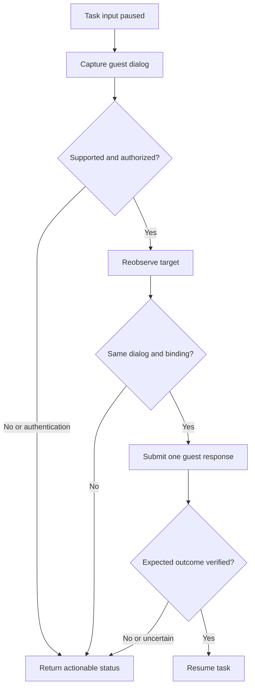

# Computer-use auto-response to permission and Keychain dialogs

**Repository:** `chr33s/iso`  
**Inspected revision:** `d01eba86a7d33f22669c11c31745f82c80d8e7af` on `main`  
**Date:** 2026-10-31  
**Status:** Partly implemented — TCC folder-access consent through
`iso-sandbox macos cu respond` (see [Implementation](#implementation)).
Keychain automation, password entry, owner leases and host dialogs remain
proposals. Sections 1–10 are the original sketch, written against the
inspected revision.

## Recommendation

Add a small **guest dialog responder** above ISO's existing computer-use transport. It should recognize a supported permission dialog, apply a policy the operator chose in advance, submit one guest input action, and verify that the blocked operation reached the expected result.

Use the existing host-owned virtual display and input path. ISO already captures a `VZVirtualMachineView` and delivers input directly to that view; its trust model says this requires no host Accessibility or Screen Recording permission. The repository also records a successful Terminal/Desktop TCC consent test on its development host. That is a concrete starting point for guest permission automation. It does not establish Keychain coverage. [R1], [R2], [R3], [R12]

The first version should support ordinary qualified guest consent dialogs and, after a small real-guest experiment, Keychain item consent that needs no authentication. Password entry, persistent Keychain trust, and host permissions should have separate designs.

## Implementation

Implemented on 2026-10-31, scoped to the first row of §2 and the
transaction in §4. Everything else in this sketch is still a proposal.

**Where it lives.** `iso` has no computer-use surface; the transport and its
callers are in `iso-sandbox`. The responder therefore sits beside
`cu session/frame/act` rather than under `Sources/IsoHost/` (§8):

| Piece | File |
| --- | --- |
| Expectation, classifier, policy, transaction (pure) | `iso-sandbox/Sources/IsoSandboxCore/MacOS/CUDialog.swift` |
| Transport over `cu-frame`/`cu-act`, Vision recognition | `iso-sandbox/Sources/IsoSandboxCore/MacOS/CUDialogTransport.swift` |
| CLI | `iso-sandbox macos cu respond` in `iso-sandbox/Sources/IsoSandbox/MacCommands.swift` |
| Unit tests (scripted transport, rendered-frame OCR) | `iso-sandbox/Tests/IsoSandboxTests/MacDialogResponderTests.swift` |
| Real guest | Gate R in `tests/macos-guest-qualify.py` |

**Interface.** One invocation handles one prompt occurrence:

```sh
iso-sandbox macos cu respond VM --root ROOT --session SESSION \
  --expect '{"prompt":"tcc.folder_access","requester":"Terminal","resource":"desktop","response":"allow"}' \
  [--mode observe|auto] [--wait-seconds 20] [--verify-seconds 10]
```

`--wait-seconds` and `--verify-seconds` are wall-clock windows, checked
between frames (one frame request may itself take up to the owner call's
120 s timeout). It always
prints `{"outcome", "prompt", "response", "attempted"}` plus `reason` when
there is one: fixed enums and a boolean, never recognized text. Outcomes are
`proposed` (observe mode), `responded`, `needs_user`,
`needs_authentication`, `setup_required`, `outcome_unknown` and
`invalidated`. Only argument errors exit non-zero; an unknown or stopped
sandbox reports `needs_user` (`owner_unreachable`).

**Behavior.**

- The expectation replaces the policy file of §5: the caller names the
  one prompt it has just triggered. It decodes strictly (unknown fields
  refused); only `tcc.folder_access` with `desktop`, `documents` or
  `downloads` and `allow` or `deny` is accepted. The requester must match
  the displayed name exactly.
- Recognition (English) needs the `"NAME" would like to access files in your
  FOLDER folder.` sentence (OCR may wrap it or drop a quote mark) and exactly
  one `Allow` and one `Don't Allow` near it. A lone Allow, missing or
  duplicate buttons, or two prompts is `needs_user`; a partly drawn dialog
  keeps the wait going. Fixed authentication phrases ("enter your
  password", "use password", "Touch ID", "wants to make changes", …) or a
  Keychain prompt mentioning a password give `needs_authentication`; a
  Keychain consent prompt gives `needs_user` (`keychain_not_qualified`); an
  `Open System Settings` button gives `setup_required`. The most
  restrictive family wins. Keychain and Settings text block wherever they
  are; authentication phrases block when they are inside the alert, or
  anywhere when there is no consent prompt on screen. The two buttons
  must sit side by side or stacked; an `Allow` elsewhere within reach is
  not taken for the alert's. The sentence may wrap anywhere.
- After the decision the responder captures again. The click is sent only if
  the same requester, folder and button positions (±6 px) are seen on a frame
  at most 5 s old (owner timestamps are whole seconds, so up to 6 s), and it
  carries that frame as `basedOnFrame`. The requester must already be in the
  form OCR text takes: single-spaced, no quote marks.
- Cancellation after the click reports `outcome_unknown` (`cancelled`).
- At most one click. A lost reply is never replayed: the responder
  re-observes and reports `outcome_unknown`. A binding refusal up to and
  including the click is `invalidated`; an unreachable owner before the
  click is `needs_user` (`owner_unreachable`); any failed observation after
  the click is `outcome_unknown`.
- `responded` needs positive evidence that the dialog is gone: two frames in
  a row with no prompt sentence, or a different request in its place. Blank or
  ambiguous frames keep the verify window going and end `outcome_unknown`.
  An authentication or System Settings dialog that follows the click is
  reported as such. The caller still checks the operation's own result
  (Gate R checks the command succeeded) before resuming.
- Recognition is bounded: the image must be a PNG of the owner's 1920×1200
  frame, and a frame with more than 512 lines, or a line over 256
  characters, is `needs_user` (`too_much_text`) rather than classified
  truncated.
- Owner refusals are classified by the control response's `refusal` code
  and `beforeInput` flag, never by message text. A click refused before any
  input is `needs_user` (`input_refused`) or, for a void binding,
  `invalidated`, both `attempted: false`; any other failed click counts as
  attempted. A response without a code counts as a lost reply.
- While waiting for the dialog, each frame is first read with Vision's fast
  level; only a frame with a dialog word ("would like", "allow",
  "password", …) gets the accurate read. Re-observation and verification
  always use the accurate read.

**Qualified (development bar).** Gate R passed on 2026-10-31 (run
`20261031T181551-0245`, template `macos27`, macOS 27.0.1 build 26A434) on
the development host: a wrong requester returned `requester_mismatch` with
no input, observe mode returned `proposed`, and auto mode returned
`responded` with the guest's `ls ~/Desktop` then succeeding.

**Not done.** Keychain qualification (Phase 1), recurrence budgets across
invocations (the caller's), owner-enforced leases (single controller
assumed; the owner already refuses a concurrent action), restart recovery,
audit events (`iso-sandbox` writes no `iso audit` records), and host
dialogs.

## 1. What ISO already provides

| Existing capability | Evidence | Consequence for this feature |
| --- | --- | --- |
| Guest framebuffer and virtual keyboard/pointer | `MacScreen` owns an ordered-out VM view and calls its input methods. [R1] | Reuse the current path; no new desktop automation driver for the MVP. |
| Session identity | `CUBinding` includes owner boot, VM instance, guest boot, helper generation, and display dimensions. [R4] | Invalidate pending responses whenever that binding changes. |
| Frame-associated actions | `basedOnFrame` is optional and checks a retained frame's binding. The table retains 64 frames. [R4] | Require a frame for responder actions, and add a separate freshness/revalidation rule. |
| Action serialization | `MacScreen.acting` prevents overlapping actions. [R1] | This does not reserve the entire observation–decision–verification interval. |
| Submission acknowledgement | `submitted` counts events handed to the view, without proving delivery. [R5] | Verify the operation; do not treat a successful RPC as a resolved prompt. |
| A real TCC test | Gate R (at the inspected revision) opens Terminal, requests Desktop access, finds Allow, clicks, and checks command completion. [R3] | Promote the scenario into a stricter prompt fixture; do not promote its first-text-match heuristic unchanged. |
| OCR fixture | `frame-ocr.swift` uses Vision and returns text, confidence, and pixel bounds. [R6] | Start with local bounded recognition over the existing frames. |
| Guest password lifecycle | Template provisioning generates a random password, uses it in memory, and does not retain it as a runtime credential. [R7] | The responder cannot assume it can supply the `iso` login/keychain password. |
| Current policy and audit conventions | Existing policy governs three named operations; audit records metadata and excludes prompt content, argv, secrets, and hashes of that content. [R8], [R9] | A dialog policy is a new capability. Reuse conventions without pretending current policy already covers it. |

At the inspected revision the CLI surface is `session`, `frame`, and `act`. For example, these are command templates with returned identifiers and detected numeric coordinates substituted by the caller: [R10]

```sh
iso-sandbox macos cu session VM --root ROOT
iso-sandbox macos cu frame VM --root ROOT --session SESSION --out FRAME.png
iso-sandbox macos cu act VM --root ROOT --session SESSION \
  --based-on-frame FRAME_ID --action '{"kind":"click","x":X,"y":Y}'
```

The final argument above is a template, not valid JSON until `X` and `Y` are replaced by numbers. Coordinates must come from the current observation. No `dialogs`, `respond`, or `watch` command existed at that revision; `respond` is now implemented (see [Implementation](#implementation)). [R10]

## 2. Separate the kinds of prompt

| Prompt family | Proposed handling | Qualification or scope |
| --- | --- | --- |
| Guest TCC consent, such as Terminal requesting Desktop access | Auto-select the configured response for an expected workflow. | First supported case; authorize the resulting guest permission, including persistence. |
| Guest Keychain item access, without a password or authentication requirement | Prefer the one-access response when a matching rule permits it. | Add a real Keychain fixture before enabling. |
| Guest Keychain persistent trust | Only a rule explicitly naming persistent trust may select Always Allow. | Defer from MVP. |
| Locked keychain, account password, administrator authentication | Return `needs_authentication`. | Requires an independently designed guest credential lifecycle. |
| User-presence or biometric authentication | Report the required authentication step. | A button click does not satisfy the underlying authentication constraint. [A3] |
| Permission flow that opens System Settings or requires app restart | Recognize the transition, then enter an explicitly supported setup workflow or report `setup_required`. | A single click is not proof that permission is effective. |
| Unknown dialog or ambiguous requester/resource | Return `needs_user`; keep the task input paused. | Do not invent an allow or deny choice. |
| Host Keychain or host OS permission | Route to a host setup/authentication result. | The guest VM view neither observes nor controls the host desktop. [R1], [R2] |

Apple distinguishes current-access consent from ongoing access for Keychain items. For traditional macOS keychain ACLs, persistent approval changes the trusted-app list for the relevant item operation. Keep those effects separate from unlocking a keychain. [A1], [A2]

A responder decision may be valid for one attempt while its OS effect persists on the guest disk. The policy must describe both lifetimes. Revoking an ISO response rule prevents future automated responses; it does not undo a permission that macOS already saved.

## 3. Architecture

Place recognition and policy in a host-side controller above the small VM transport. Start with one controller owning the VM's CU input stream. Keep the existing root guest management helper focused on its current closed protocol. [R2]



### Components

**DialogObserver** consumes a current guest frame. It extracts a bounded candidate: prompt family, displayed requester/resource hints, dialog bounds, complete button set, any authentication controls, recognition version, and observation time. Pixel text is data, never instructions or authority to change the policy.

**PromptPolicy** matches that candidate against a trusted host policy and an expected task operation. It returns a semantic response such as `allow`, `allow_once`, `deny`, or a reason that automation cannot proceed. Recognition confidence does not supply authorization.

**DialogResponder** coordinates input ownership, final reobservation, one submission, result checking, and task continuation. It returns an explicit outcome rather than a boolean.

**GuestCUTransport** wraps the existing `cu-session/frame/act` surface. Add only the owner-level primitives needed to enforce concurrent input ownership or future recovery; do not put OCR or model calls inside the VM owner.

### Identity limits

A screenshot exposes displayed labels, not a verified executable identity or a unique Keychain item identifier. Call those fields `requesterHint` and `resourceHint`, not authenticated bundle IDs.

For MVP, enable automation only in a controlled guest image and a known workflow that has deliberately triggered the expected request. If a rule requires stronger identity evidence than the available observation provides, it cannot match. A future guest metadata adapter may improve correctness, but guest-provided metadata remains untrusted at the host boundary. ISO deliberately treats the entire guest as untrusted. [R2]

This feature controls the responder's decisions. It is not a new isolation boundary against an agent that already has guest root or arbitrary guest CU access.

## 4. The response transaction

1. **Establish the expected operation.** Bind a host-authorized workflow and policy snapshot to the VM/session. Open a short expectation window when the task triggers an operation likely to request permission. An unrelated prompt elsewhere on the desktop must not acquire that operation's authorization.

2. **Pause further task input.** Let the application waiting on permission keep running. The main agent must stop typing and clicking while the responder owns the next interaction.

3. **Observe and classify.** Use the full dialog context, button alternatives, and current workflow. Reject a lone Allow string, known web/app lookalikes, candidates whose origin is ambiguous, overlapping candidates, unknown layouts/locales, or an authentication field. Pixel recognition cannot exclude every spoof. Recognition should have bounded image size, text length, candidates, and polling.

4. **Evaluate the rule.** Match guest scope, workflow, prompt family, requester/resource expectations, response, persistence, and recurrence budget. Explicit deny may click a qualified deny control. Unknown is distinct from denied.

5. **Capture again and revalidate.** Check binding, short observation age, dialog family, relevant text, button set, bounds, and response location immediately before action. Compare the dialog region rather than requiring the entire desktop to remain identical. Animated background pixels should not force endless restarts.

6. **Record the attempt and submit once.** Mark a random decision/episode ID attempted before sending the guest click, and require `basedOnFrame`. Never substitute Return or a guessed default button. The first release makes at most one automatic submission per prompt occurrence.

7. **Verify the effect.** Observe that the matching dialog is gone or has made the expected transition, and check an independent functional result: the file operation completed, the fixture received the expected Keychain item, or the explicit deny produced its expected failure. Only then resume the task.

8. **Handle uncertainty explicitly.** On a lost reply, timeout, changed dialog, or missing functional result, reobserve without replaying the click. Return `outcome_unknown` if the result remains ambiguous. On boot/helper/geometry changes, return `invalidated` and discard the old decision.

A fresh frame reduces the time-of-check/time-of-use race; it cannot atomically bind a coordinate to a macOS security object. The guest can still change between capture and click. This is an automation reliability contract within the VM boundary.

### Concurrency and recovery

The simplest supported MVP has one coordinating CU controller per VM and no competing raw CU clients. A lock private to the responder cannot stop other callers.

Before advertising multi-client support, add an **owner-enforced controller lease** covering final observation through verification. Every CU action caller must participate; bind the lease to session/owner generation, bound its duration, release held inputs on cancellation, and invalidate it on lifecycle changes. This is additional behavior beyond current action serialization. [R1], [R4]

An attempt marker gives at-most-once submission intent, not exactly-once delivery. A crash after marking but before sending can lose an action. Initially, a restarted responder should stop and require a fresh workflow instead of replaying pending grants. Durable metadata-only attempt state and runtime request receipts can come later if unattended recovery is needed.

Use a bounded prompt count and verification deadline for each workflow. Repeatedly recreated dialogs should end in a visible failure, rather than an indefinite clicking loop.

## 5. Proposed policy shape

The following is **illustrative new configuration**. Current ISO does not accept these fields. Its existing `policy.actions` list should not be silently extended by a caller. [R8]

```jsonc
{
  "computer_use": {
    "permission_responses": {
      "mode": "auto",
      "scope": "guest_only",
      "unknown": "needs_user",
      "rules": [
        {
          "id": "terminal-desktop",
          "workflow": "terminal-desktop-read",
          "prompt": "tcc.desktop",
          "response": "allow",
          "effect": "persistent_guest_permission",
          "max_prompts_per_workflow": 1
        },
        {
          "id": "fixture-keychain-read",
          "workflow": "fixture-keychain-read",
          "prompt": "keychain.item_access",
          "keychain_ref": "task-fixture",
          "item_ref": "fixture-token",
          "response": "allow_once",
          "requires_authentication": false,
          "max_prompts_per_workflow": 1
        }
      ]
    }
  }
}
```

The workflow definitions must supply the expected requester/resource and the success probe. The fixture references above name configured test resources, not arbitrary labels copied from a screenshot. A mismatch or missing evidence prevents the rule from matching.

Suggested modes are `off`, `observe`, and `auto` (implemented: `observe` and `auto`). Observe mode reports the proposed response without input. Auto mode applies previously authorized rules without asking again for every matching dialog. Changing policy invalidates an in-flight decision; the controller must establish a new snapshot before continuing.

## 6. Keychain handling

### Consent with no authentication

Start with a dedicated test keychain and synthetic item in a disposable guest. A separate requester process should trigger a real item-access prompt. Qualify the one-access response through ISO's actual VM transport and verify retrieval without printing the retrieved value.

Test persistent approval separately: make another access from a fresh requester process and then after guest reboot, with the exact macOS build and Keychain type recorded. Do not assume repeat-prompt timing from button names alone.

### A password or user-presence step appears

Classify this as an authentication transition. A keychain can be locked or have a password differing from the login password. [A4] ISO's normal guest account password is discarded after template setup; the qualification runner creates a different account for password-based login tests. [R7]

Future unattended authentication needs an explicit decision about a **task-owned guest credential**: where it is created, how it is held, who can request its use, when it expires, and what survives a clone. A dedicated task keychain may make that lifecycle simpler than reusing a login keychain.

The current `cu act --action` JSON is passed in argv. It is unsuitable for secret entry. Before supporting passwords, add private stdin/IPC or a guest-local secret operation, suppress value logging and model exposure, and handle screenshots/recording during entry. A literal password in policy or action JSON is not the design. [R10]

### Persistent authorization and template reuse

For repeatable workloads, intentionally provision the exact guest app and task-owned item using the platform's supported access-control mechanism. This can remove a repeated prompt, but the persistent grant must be a deliberate part of the guest image or task setup.

Never let an incidental Always Allow click silently become a template default. Treat guest grants and Keychain contents as persistent guest state; use clean disposable clones for qualification and document any preconfigured grants.

### Host Keychain

ISO also has a separate host Keychain path: `SecretStore.swift` creates references resolved by host credential handling. [R11] A dialog from that path is not inside the VM framebuffer.

Prefer resolving host credential consent during an explicit host setup flow, scoped to the intended requester and item. A future host UI responder would be a separate host capability, with its own OS permissions and authorization rules. Guest screenshots, guest commands, and guest metadata must never activate it or request the host login password.

## 7. Optional adapters and provisioning

Keep AX out of the first implementation unless pixel recognition proves inadequate. An eventual guest GUI-session adapter could provide structured dialog information or semantic actions. Accessibility trust still has to be established; a trust-query API does not grant it, and AX action completion can be ambiguous. [A5], [A6]

Do not add GUI duties to the existing root management LaunchDaemon merely because it runs as root. Use a separately designed GUI-session component if necessary. [R2]

Supported image setup or device management may reduce some permission prompts. The exact service and OS build matter: Apple's classic PPPC ScreenCapture setting cannot silently grant capture access, and current management documentation has macOS 27 changes. This is optional provisioning, not a universal way to approve every dialog. [A7]

## 8. Concrete code seams

All new names below are proposals.

| Area | Existing location | Proposed work |
| --- | --- | --- |
| Controller | Host orchestration under `Sources/IsoHost/` | Add `ComputerUse/DialogResponder.swift` with a small explicit state machine. |
| Recognition | `tests/fixtures/macos-guest/frame-ocr.swift` | Extract a bounded detector; add a versioned catalog of real prompt fixtures. |
| Decisions | Host configuration, beside current validated policy concepts | Add typed prompt family, semantic effect, policy snapshot, and rule matching; reject unknown fields. |
| Input ownership | `iso-sandbox/Sources/IsoSandboxCore/MacOS/MacScreen.swift` | Enforce the declared controller model; add an owner lease only when multi-client support is required. |
| Session/frame contract | `CUModel.swift`, `MacOwner.swift` | Retain binding checks; add explicit response/lease metadata only as needed. Keep acknowledgement distinct from verification. |
| CLI | `iso-sandbox/Sources/IsoSandbox/MacCommands.swift` | Keep transport commands small. Any higher-level observe/respond command is new and should be labeled accordingly. |
| Unit tests | `iso-sandbox/Tests/IsoSandboxTests/MacComputerUseTests.swift` and host tests | Cover classification, policy, lifecycle invalidation, uncertainty, and concurrency behavior. |
| Real guest tests | `tests/macos-guest-qualify.py` and macOS fixtures | Expand Gate R; add Keychain-specific qualification with functional oracles. |
| Documentation | `docs/design/`, configuration, trust model, machine interface, audit | Record proposed versus supported scope and align any public fields with examples. |

Audit only bounded metadata: VM/boot/run identity, random episode/decision ID, rule ID, prompt-family enum, selected semantic response, and outcome. Do not persist dialog text, item labels, screenshot/OCR content, secrets, or hashes derived from that content in `iso audit`. Keep transient matching material separate and discard it. This follows the existing audit contract. [R9]

## 9. Implementation order and acceptance

### Phase 1 — Observe and establish Keychain feasibility

Build observation-only recognition for the existing Terminal/Desktop scenario. Add a small native requester and synthetic Keychain item, then exercise the real unlocked-consent and locked-authentication variants through the existing VZ transport.

Deliver a build/locale/prompt support matrix with observed success and refusal cases. Run on a disposable guest; do not infer behavior from an imitation dialog alone.

### Phase 2 — Automate the qualified consent catalog

Add host-authored rules, one input controller, final recapture, one response attempt, bounded result verification, and explicit outcomes. Support TCC consent and only the Keychain variants actually qualified in Phase 1. Default password/user-presence and persistent Keychain approval to an actionable blocked result.

### Phase 3 — Add only demonstrated needs

Add owner-enforced leases for multiple clients, restart recovery, additional dialog families, optional AX metadata, or private guest credential entry as separate changes. Each should address a measured limitation from real workflows.

### Essential acceptance cases

| Case | Required result |
| --- | --- |
| Expected TCC or qualified Keychain request | Correct response and independent operation result observed. |
| Wrong requester/resource, unrelated Allow text, or multiple candidates | No automatic input. |
| Password field or authentication transition | `needs_authentication`; no guessed credential or generic Return. |
| Persistent versus single-access permission | Recorded effect matches the rule, including a later request and reboot where applicable. |
| Dialog moves/replaces during processing | Revalidation rejects it, or ambiguous post-action state is reported honestly. |
| Lost acknowledgement after submission | Reobserve; no duplicate automatic click. |
| Session/boot/helper/geometry changes | Old decision refused. |
| Competing input caller | Refused under owner-lease mode, or rejected as outside the declared single-controller scope. |
| Repeating prompt | Bounded recurrence stops visibly. |
| Guest-controlled spoof or metadata | Cannot change host policy, obtain host credentials, or generate host-desktop input. |
| Logging and recovery | No secret or prompt-content artifacts in audit; no grant replay after restart. |
| Clone isolation | Test credentials, grant assumptions, and stale decisions do not unintentionally carry between test instances. |

Suggested terminal outcomes (implemented as listed under [Implementation](#implementation), with `responded` for both resolved and denied): `resolved`, `denied`, `needs_user`, `needs_authentication`, `setup_required`, `outcome_unknown`, and `invalidated`. A paused task resumes only after a verified result or an explicit caller resolution with a fresh observation.

## 10. Evidence and remaining uncertainty

This sketch is grounded in repository source and first-party Apple documentation. The repository's own development qualification reports a TCC success on one macOS host/guest combination; that result was not reproduced in this task. No new code was built or executed.

The first experiment should answer whether the exact targeted Keychain variants render and accept ISO's existing input path. Until that passes, Keychain automation is a proposed capability. Fresh observations, recognition, and guest result probes improve reliability but do not authenticate the guest to the host.

### Repository sources

[R1]: https://github.com/chr33s/iso/blob/d01eba86a7d33f22669c11c31745f82c80d8e7af/iso-sandbox/Sources/IsoSandboxCore/MacOS/MacScreen.swift
[R2]: https://github.com/chr33s/iso/blob/d01eba86a7d33f22669c11c31745f82c80d8e7af/docs/trust-model.md
[R3]: https://github.com/chr33s/iso/blob/d01eba86a7d33f22669c11c31745f82c80d8e7af/tests/macos-guest-qualify.py
[R4]: https://github.com/chr33s/iso/blob/d01eba86a7d33f22669c11c31745f82c80d8e7af/iso-sandbox/Sources/IsoSandboxCore/MacOS/CUModel.swift
[R5]: https://github.com/chr33s/iso/blob/d01eba86a7d33f22669c11c31745f82c80d8e7af/iso-sandbox/Sources/IsoSandboxCore/MacOS/MacOwner.swift
[R6]: https://github.com/chr33s/iso/blob/d01eba86a7d33f22669c11c31745f82c80d8e7af/tests/fixtures/macos-guest/frame-ocr.swift
[R7]: https://github.com/chr33s/iso/blob/d01eba86a7d33f22669c11c31745f82c80d8e7af/iso-sandbox/Sources/IsoSandboxCore/MacOS/MacTemplates.swift
[R8]: https://github.com/chr33s/iso/blob/d01eba86a7d33f22669c11c31745f82c80d8e7af/docs/policy.md
[R9]: https://github.com/chr33s/iso/blob/d01eba86a7d33f22669c11c31745f82c80d8e7af/docs/audit.md
[R10]: https://github.com/chr33s/iso/blob/d01eba86a7d33f22669c11c31745f82c80d8e7af/iso-sandbox/Sources/IsoSandbox/MacCommands.swift
[R11]: https://github.com/chr33s/iso/blob/d01eba86a7d33f22669c11c31745f82c80d8e7af/Sources/IsoHost/Credentials/SecretStore.swift
[R12]: https://github.com/chr33s/iso/blob/d01eba86a7d33f22669c11c31745f82c80d8e7af/docs/design/macos-guest-computer-use.md

- [Runtime implementation and recorded development qualification][R12].
- [Guest display/input implementation][R1] and [session/frame binding][R4].
- [Real TCC qualification flow][R3] and [OCR fixture][R6].
- [Submission response contract][R5] and [current CLI][R10].
- [Template credential lifecycle][R7] and [host Keychain implementation][R11].
- [Trust model][R2], [current policy scope][R8], and [metadata-only audit][R9].

### Apple sources

[A1]: https://support.apple.com/en-euro/guide/keychain-access/kyca1243/mac
[A2]: https://developer.apple.com/documentation/security/access-control-lists
[A3]: https://developer.apple.com/documentation/security/secaccesscontrolcreateflags/userpresence
[A4]: https://support.apple.com/en-euro/guide/keychain-access/kyca1242/mac
[A5]: https://developer.apple.com/documentation/applicationservices/1459186-axisprocesstrustedwithoptions
[A6]: https://developer.apple.com/documentation/applicationservices/1462091-axuielementperformaction
[A7]: https://developer.apple.com/documentation/devicemanagement/privacypreferencespolicycontrol/services-data.dictionary

- [Keychain response choices][A1] and [traditional item ACLs][A2].
- [User-presence constraint][A3] and [locked keychain/password behavior][A4].
- [Accessibility trust query][A5] and [action completion/error semantics][A6].
- [PPPC service-specific capabilities][A7].

